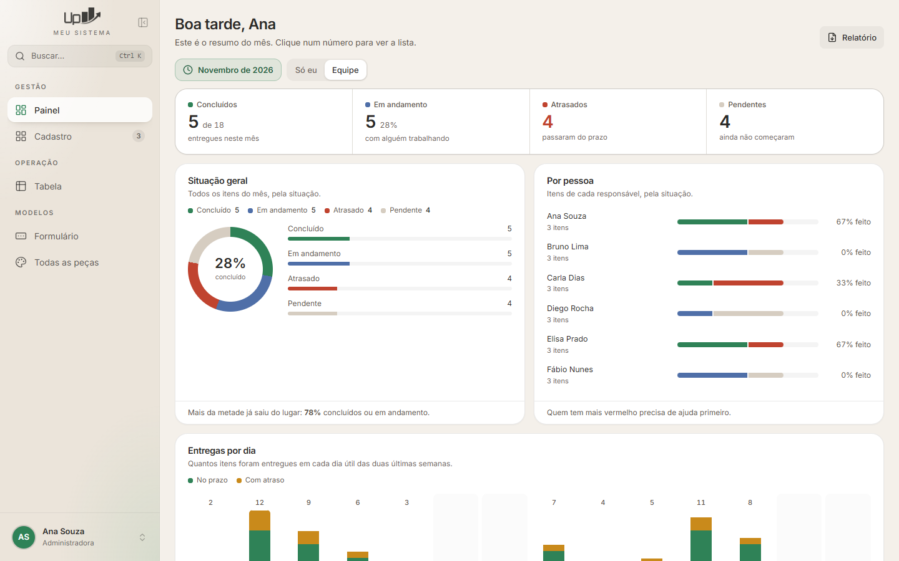
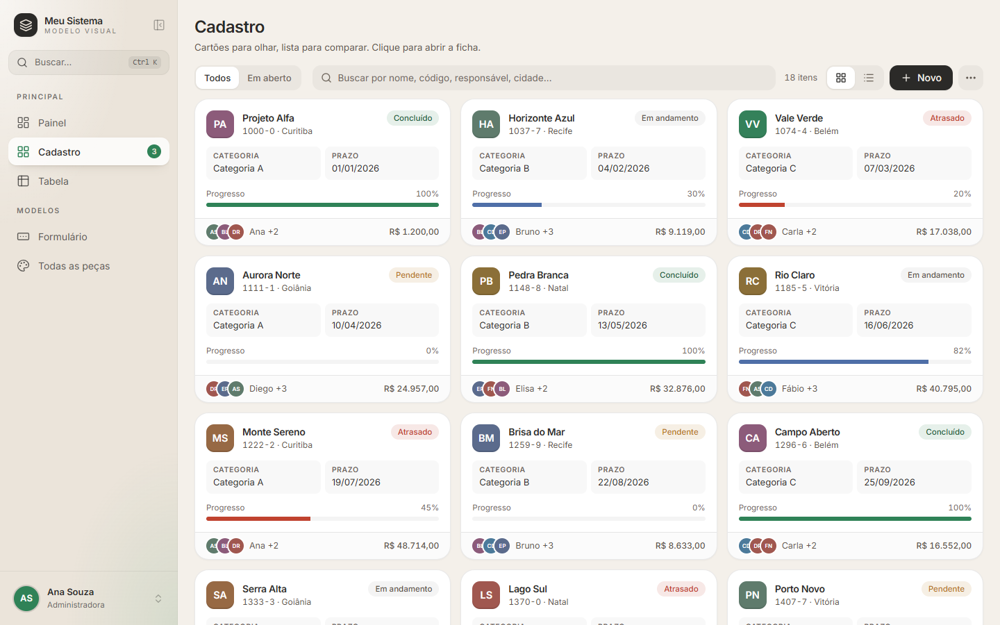
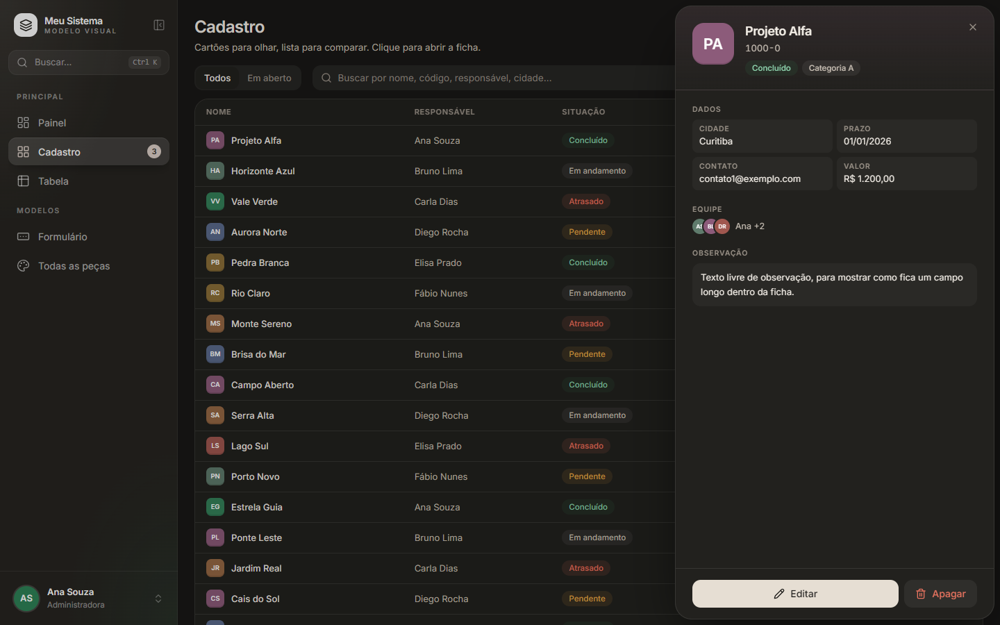
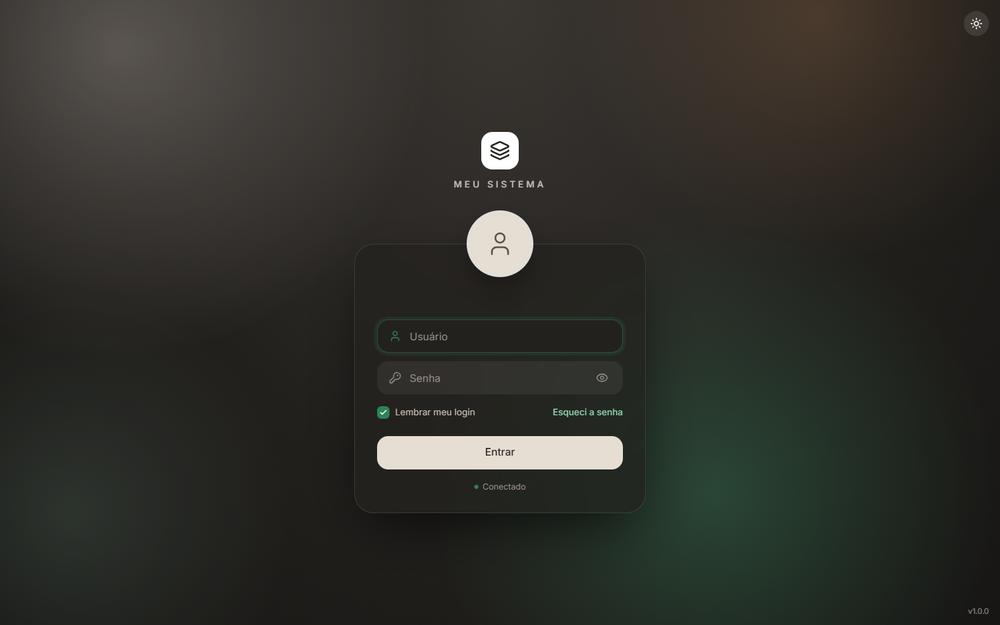
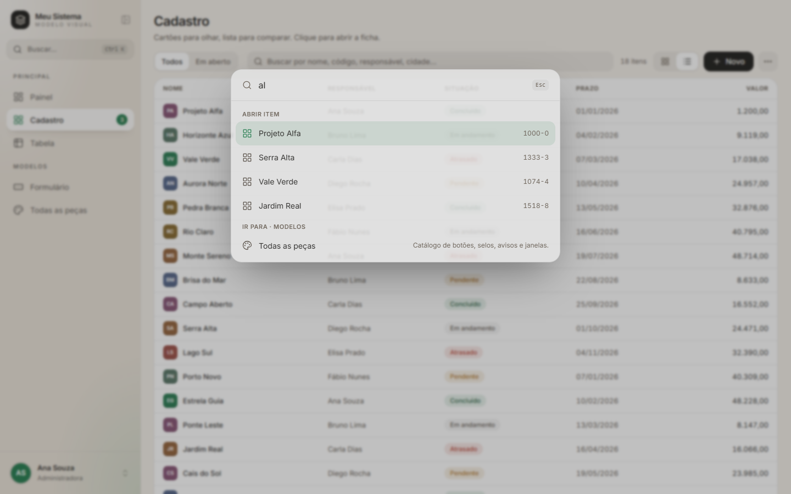
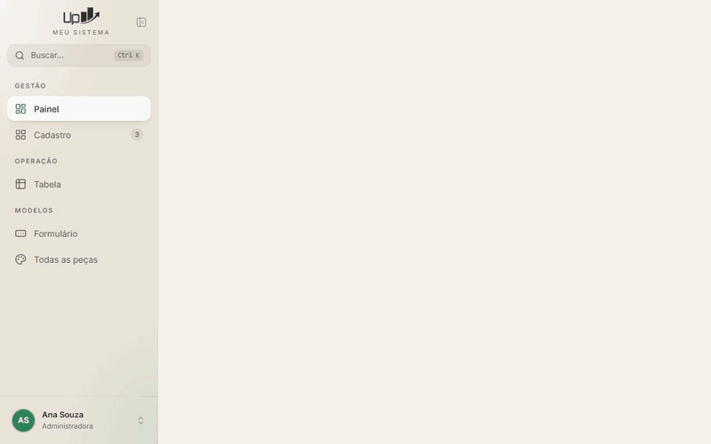
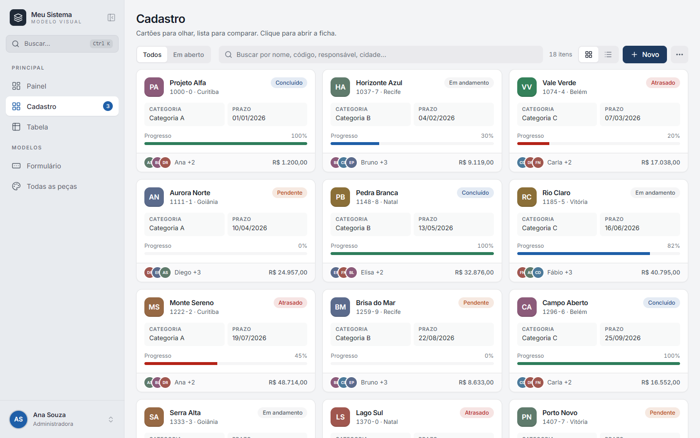
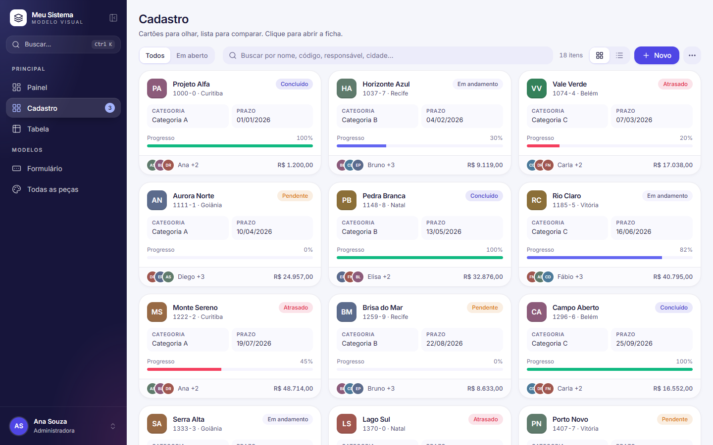
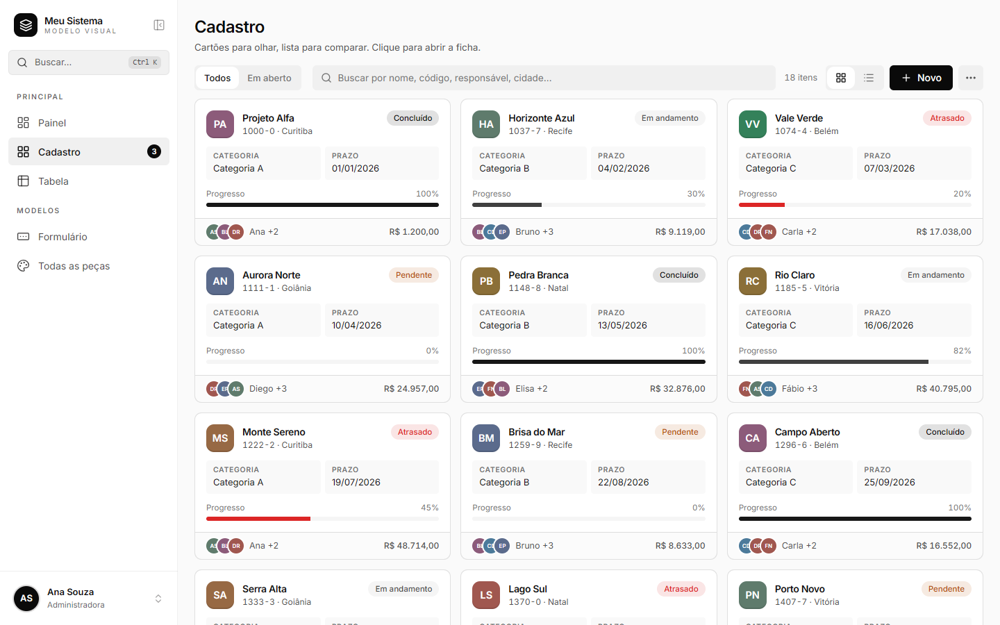

# Kit visual — casca de programa desktop moderno

Um **espelho visual** de um sistema desktop de produção: janela própria do Windows, menu
lateral que recolhe, busca Ctrl+K, cartões, fichas laterais, tabelas, gráficos, janelas com
mola, tema claro e escuro. Feito para você **apontar a sua IA para esta pasta** e ela fazer a
"cirurgia" no seu programa: trocar a casca inteira e manter as suas regras.



| | |
|---|---|
|  |  |
|  |  |



## Como usar (3 passos)

1. Clone esta pasta **ao lado** do seu projeto:
   ```bash
   git clone https://github.com/walletsistemas/visualupcontabil.git
   ```
2. Abra a sua IA (Claude Code, Codex, etc.) **dentro do seu projeto**.
3. Diga:
   > Leia `..\visualupcontabil\guia\00-comece-aqui.md` e siga o roteiro para fazer a cirurgia
   > visual do meu sistema. Me entreviste antes de mudar qualquer coisa.

A IA vai: entender o seu projeto → entrevistar você (estilo, cores, sombras, cantos,
animações, menu, nomes) → mostrar um plano → trocar tela por tela, conferindo que tudo continua
dando o mesmo resultado.

## Importante

- **A cirurgia completa usa a mesma stack do kit**: Python (FastAPI + pywebview) por trás e
  React + Tailwind nas telas. Se o seu programa é PyQt6/PySide6/Tkinter, a cirurgia **é** essa
  troca, e as suas regras em Python são reaproveitadas. O sistema que originou o kit era PyQt6 e
  trocou em **2 dias**. Ver [guia/01-postura.md](guia/01-postura.md).
- Os nomes e textos das telas de exemplo ("Meu Sistema", "Cadastro", "Projeto Alfa") são só
  exemplos com dados inventados. Os seus vêm da entrevista.
- Só Windows 10/11 (a janela usa o WebView2, que já vem no sistema).

## Ver o kit rodando

Precisa de [Node.js](https://nodejs.org/) e [Python 3.12+](https://www.python.org/downloads/).

```bash
modelo\ABRIR.bat vitrine
```
As telas no navegador, em http://localhost:5173 (com dados inventados).

```bash
modelo\ABRIR.bat
```
O programa completo, na janela própria.

## O que tem aqui

| Pasta | Conteúdo |
|---|---|
| [`guia/`](guia/00-comece-aqui.md) | O roteiro da cirurgia para a IA, a entrevista, a migração do PyQt, princípios, cores, componentes, telas, animações, instalador e a conferência final |
| `modelo/` | Um sistema-esqueleto que **roda**: `backend/` (Python), `frontend/` (telas), `empacotar/` (`.exe` e instalador) |
| `estilos-prontos/` | 4 visuais prontos: Original, Sóbrio, Moderno, Minimalista |
| `imagens/` | Fotos de cada tela e peça (claro/escuro), dos estilos e GIFs das animações |

## Estilos prontos

| Original | Sóbrio | Moderno | Minimalista |
|---|---|---|---|
|  |  |  |  |

## Licenças

Código do kit: livre para usar e adaptar. Bibliotecas: as licenças de cada uma (todas abertas;
a fonte Inter é SIL OFL e vem no pacote `@fontsource-variable/inter`, com a licença dentro).
