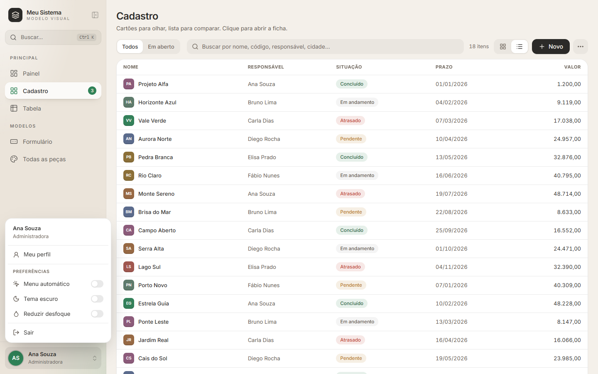
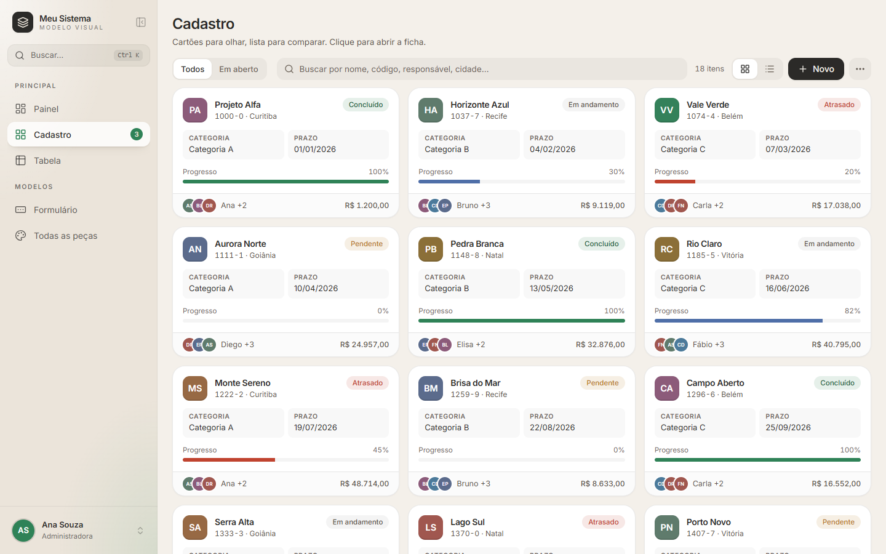
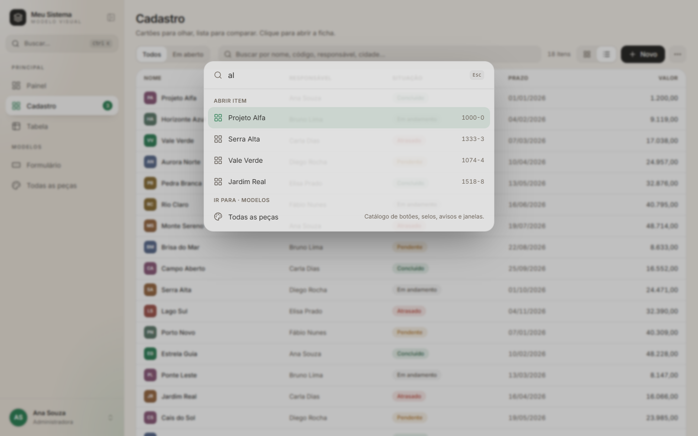

# 02 · A entrevista

> **Para a IA.** Antes de desenhar qualquer tela, pergunte. O kit dá a *forma*; o usuário dá
> a *identidade*. Faça as perguntas em **blocos de 3–4**, cada uma com opções, a sua
> recomendação (marcada) e, quando houver, a imagem. Se a sua ferramenta tem perguntas de
> múltipla escolha (ex.: AskUserQuestion), use-as. Respostas vão para `docs/visual.md`.
>
> Regras: não pergunte o que dá para descobrir no código; não pergunte tudo de uma vez;
> se o usuário disser "decide você", use a recomendação e siga.

---

## Bloco 1 · Identidade

**1. Qual é o nome que aparece na janela e no menu?**
Ex.: o nome atual do programa. Também: tem logo? Em que formato (PNG/SVG)? Tem versão clara e
escura? *(Sem logo: o kit usa um quadrado com ícone, `Marca` em `MenuLateral.tsx`.)*

**2. Qual estilo geral?** Mostre as 4 fotos de cada um (painel e cadastro, claro e escuro):

| Estilo | Cara | Bom para | Fotos |
|---|---|---|---|
| **Original** *(recomendado)* | Quente, areia + grafite + verde, vidro, sombras suaves, cantos generosos | Uso diário longo, equipe pequena, "cara de Apple" | [claro](../imagens/estilos/original-claro-painel.png) · [escuro](../imagens/estilos/original-escuro-painel.png) |
| **Sóbrio** | Cinza frio + azul-marinho, cantos menores, sem vidro | Corporativo, financeiro, jurídico, telas densas | [claro](../imagens/estilos/sobrio-claro-painel.png) · [escuro](../imagens/estilos/sobrio-escuro-painel.png) |
| **Moderno** | Índigo vibrante, menu escuro, muito arredondado, sombras com cor | Produto novo, público jovem, "cara de app" | [claro](../imagens/estilos/moderno-claro-painel.png) · [escuro](../imagens/estilos/moderno-escuro-painel.png) |
| **Minimalista** | Preto e branco, sem sombra nem vidro, bordas finas | "Limpo e sério", PCs fracos | [claro](../imagens/estilos/minimalista-claro-painel.png) · [escuro](../imagens/estilos/minimalista-escuro-painel.png) |

Pode misturar: "o Sóbrio, mas com o verde do Original".

**3. Tem cores da marca?** Peça os códigos (ou o logo para extrair). A cor principal vira o
`--acento`; confira contraste do texto branco em cima (se ficar ruim, use o tom mais escuro e
ajuste `--sobre-acento`). Avise se a cor da marca é vermelha/laranja: ela compete com
`--perigo`/`--alerta`, então escolha outra para "erro".

**4. Tema escuro?**
- Claro e escuro, a pessoa escolhe no menu da conta *(recomendado)*
- Só claro · Só escuro · Segue o Windows

---

## Bloco 2 · Forma e movimento

**5. Sombras?**
- Suaves, só para separar camadas *(recomendado; Original)*
- Quase nenhuma (Sóbrio) · Nenhuma, só bordas (Minimalista) · Marcadas e coloridas (Moderno)

**6. Vidro (fundo translúcido e desfocado na busca, na entrada e atrás das janelas)?**
- Sim, com a opção "Reduzir desfoque" no menu da conta *(recomendado)*
- Não (`--desfoque: 0px`; bom para PC fraco)

**7. Cantos?**
- Generosos: 12 px nos botões, 20 px nos cartões *(recomendado)*
- Discretos: 8/12 px (Sóbrio) · Retos: 6/10 px (Minimalista) · Bem redondos: 14/24 px (Moderno)

**8. Animações?** Mostre os GIFs de [../imagens/animacoes/](../imagens/animacoes/).
- Completas, com mola (menu deslizando, janelas crescendo, cartões em cascata) *(recomendado)*
- Discretas: só aparecer/sumir, mais rápidas, sem balanço
- Mínimas (o kit já respeita "reduzir animações" do Windows de qualquer jeito)

**9. Densidade?**
- Confortável: campos de 40 px, linhas de lista de 44 px *(recomendado para cadastro)*
- Compacta: campos de 36 px, linhas de 32 px *(recomendado para telas de muitos números)*
Pode ser por tela.

---

## Bloco 3 · Organização

**10. Menu lateral.** Mostre o mapa de telas que você fez na Fase 1 e proponha as **seções**
(títulos em caixa alta) e a ordem. Pergunte:
- Os nomes das seções e das telas (proponha os atuais do programa).
- Ícone de cada tela (proponha da biblioteca Lucide; mostre o nome do ícone).
- Telas só para administrador? (a seção some para quem não pode).
- Contadores na bolinha (ex.: pendências)?
- Menu começa aberto, recolhido (só ícones) ou automático (abre ao passar o mouse)?



**11. Primeira tela depois de entrar?**
- Um **painel** com números e gráficos do dia *(recomendado se houver o que medir)*
- A tela mais usada direto

**12. Para cada tela de lista:** cartões, lista/tabela ou os dois (com alternador)?
O que aparece no cartão (no máximo: nome, 1 linha de detalhe, 1 selo de situação, 2–4 dados,
pessoas e um valor). Clicar abre **ficha lateral** (gaveta) ou **tela inteira**?


**13. Tela de entrada (login)?**
- Com fundo animado e cartão de vidro *(recomendado)*
- Simples, sem animação
- Não tem login (abre direto na janela principal)

---

## Bloco 4 · Comportamento

**14. Busca rápida (Ctrl+K)?** O que ela deve achar: telas, ações ("novo X"), registros (quais)?


**15. Confirmações.** Quais ações pedem "tem certeza?" (sugestão: apagar, sobrescrever,
enviar para outros). As demais avisam com balão de sucesso.

**16. Textos.** Tratamento: "você" ou impessoal? Português do Brasil? Formato de data
(dd/mm/aaaa) e de dinheiro (R$ 1.234,56)?

**17. Atalhos de teclado** que a equipe já usa no programa antigo (o kit já tem Ctrl+K e
Ctrl+B). Os antigos devem continuar funcionando.

---

## Fechamento

Mostre um resumo de uma tela com as respostas (estilo, cores, cantos, sombra, vidro, animação,
seções do menu, primeira tela) e peça o "ok". Grave em `docs/visual.md` neste formato:

```md
# Receita visual
- Estilo base: Original · Acento: #1f6f5c · Escuro: sim (escolha no menu)
- Sombras: suaves · Vidro: sim + "Reduzir desfoque" · Cantos: generosos · Animação: completa
- Densidade: confortável (Tabela X: compacta)
- Menu: Seção "Principal": Painel, Clientes, Pedidos · Seção "Admin" (só admin): Usuários
- Primeira tela: Painel · Login: com fundo animado
- Busca: telas, ações, clientes por nome/código
- Confirmar antes de: apagar, enviar
```
