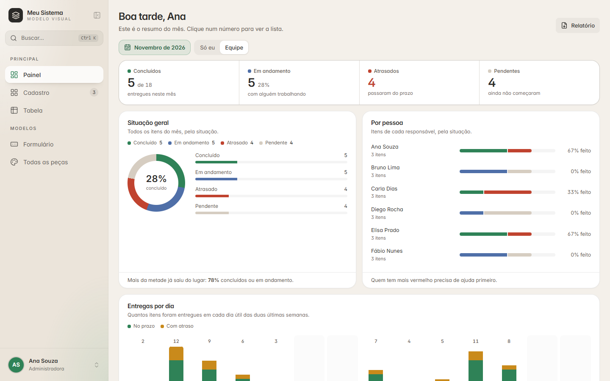
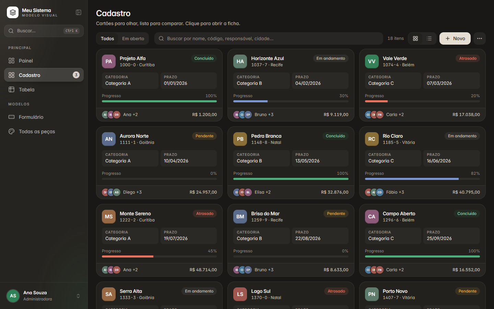
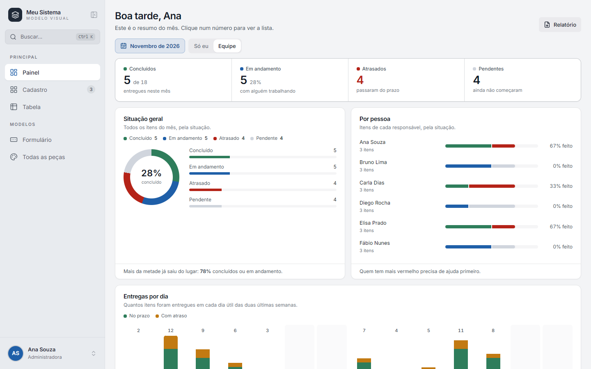
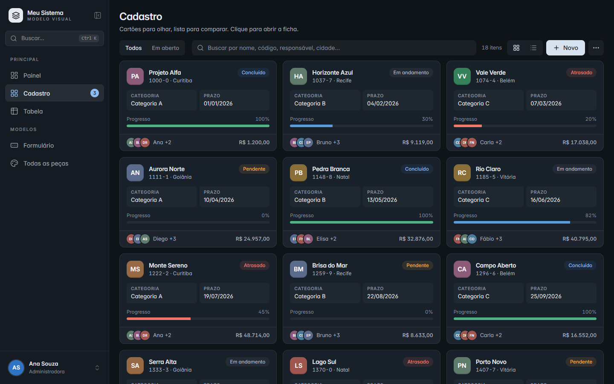
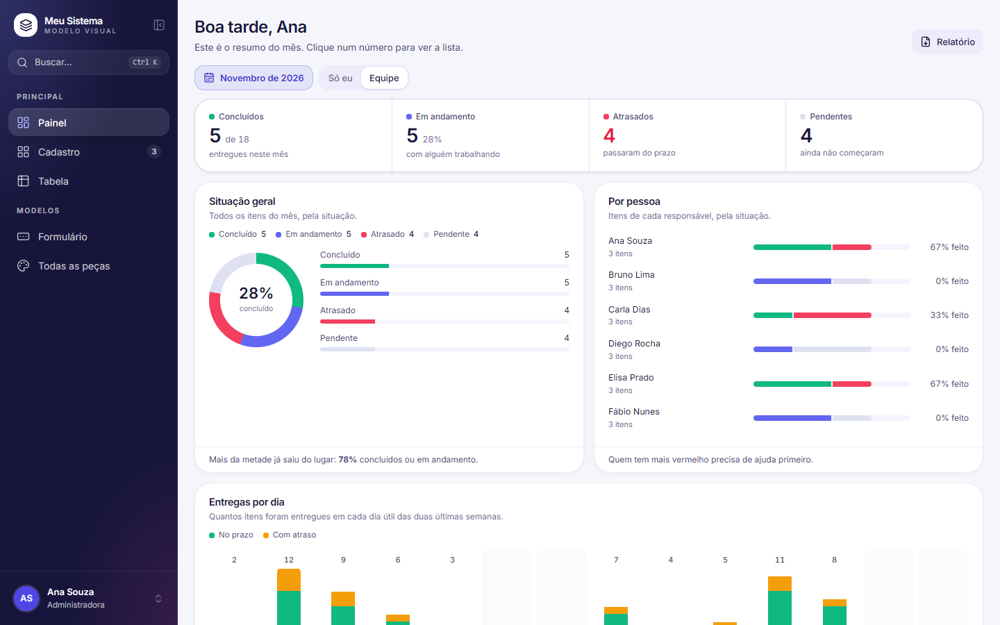
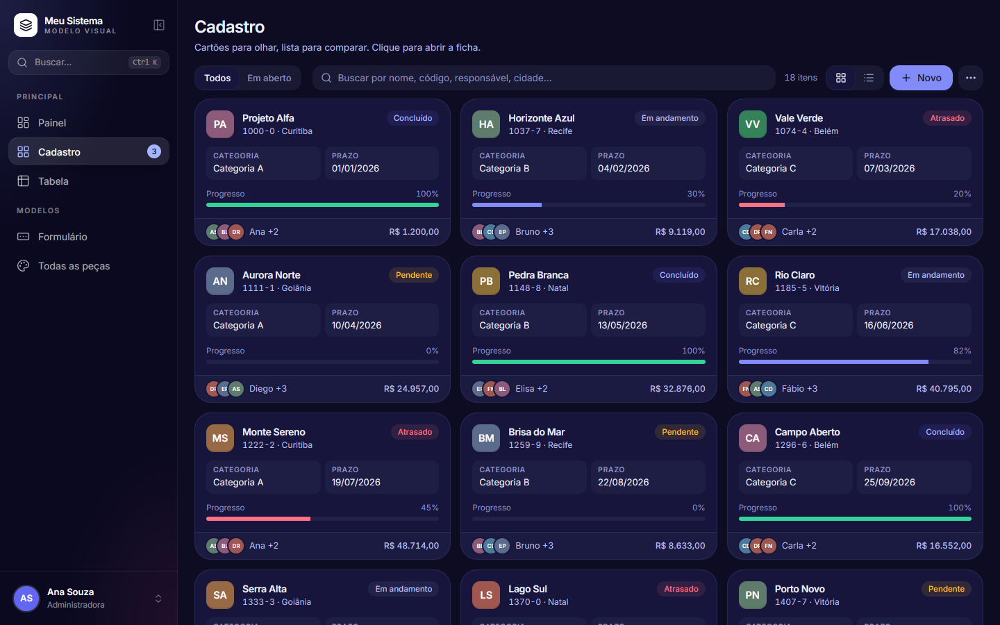
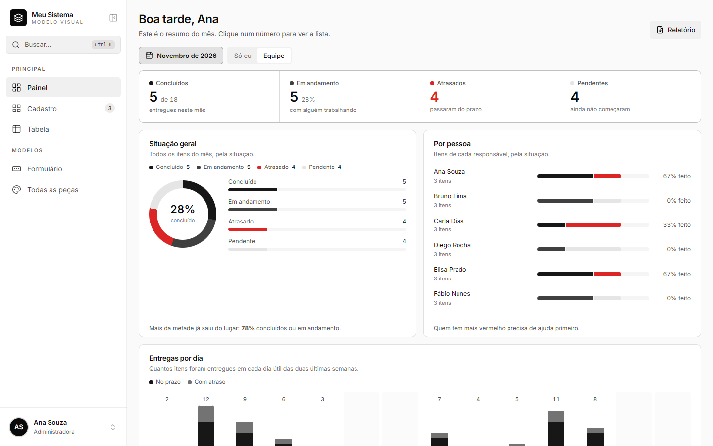
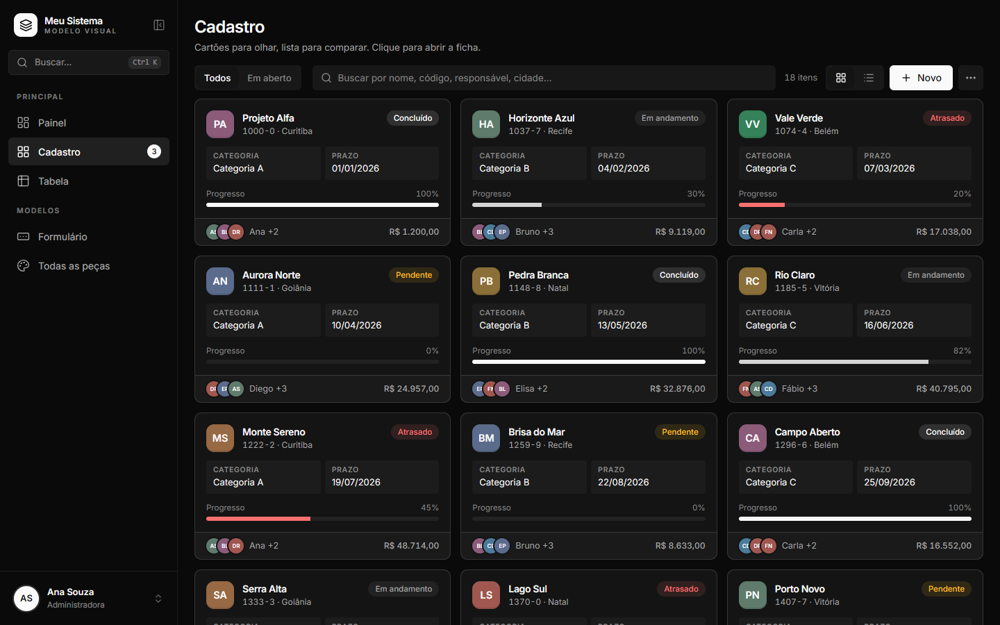
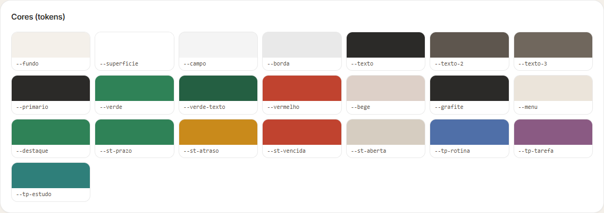
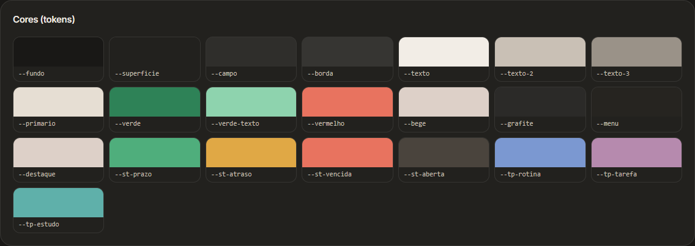

# 07 · Cores e medidas (tokens)

> **Para a IA.** Toda a aparência mora num arquivo só: `modelo/frontend/src/tema/tokens.css`.
> Este capítulo lista cada token, a classe Tailwind que o usa, a escala de texto e de medidas,
> e como trocar ou criar um estilo a partir das respostas da entrevista.

As cores do modelo (areia, grafite, verde) são **exemplo**. Na cirurgia, cores, nome e logo vêm
da entrevista ([02-entrevista.md](02-entrevista.md)). O que fica do kit são os **nomes** dos
tokens e as **regras** de uso.

## Como funciona

`tokens.css` tem três blocos:

1. `:root { ... }` — valores do tema **claro**.
2. `.escuro { ... }` — o que muda no tema **escuro** (classe `escuro` no `<html>`, posta por
   `aplicarTema()` em `src/tema/tema.ts`). Token que não aparece aqui herda o valor do claro.
3. `@theme inline { ... }` — liga cada token a uma classe do Tailwind 4. **Não mexa** neste
   bloco ao trocar de estilo.

O `src/index.css` importa o Tailwind e os tokens e define `@custom-variant dark (&:where(.escuro, .escuro *));`,
então `dark:` também funciona com a classe `.escuro`. O tema começa pelo que está guardado
(`localStorage` chave `tema`) ou, sem nada guardado, pelo tema do Windows.

## Regras

- **Componente nunca usa cor, raio ou sombra soltos.** Nada de `#3a7`, `bg-green-600`,
  `rounded-[13px]`, `shadow-lg`. Use o token (`bg-acento`, `rounded-cartao`, `shadow-pop`).
  Transparência sobre token é permitida (`bg-acento/12`, `border-acento/40`, `text-tinta/70`).
- **Texto por cima do acento usa `text-sobre-acento`**, nunca `text-white`. Em estilos com
  acento claro (o minimalista escuro tem acento quase branco) o `--sobre-acento` é escuro.
- **Acento como texto usa `text-acento-texto`** (versão mais escura no claro e mais clara no
  escuro, para ter contraste de leitura). `text-acento` só em ícone ou detalhe pequeno.
- **Texto tem 3 níveis e só 3:** `text-texto` (principal), `text-texto-2` (secundário),
  `text-texto-3` (legenda, placeholder, ícone apagado).
- **As 7 cores de gráfico (`--g-1` a `--g-7`) têm significado fixo** em todas as telas:
  verde = bom/concluído, âmbar = atenção, vermelho = problema, cinza = neutro/ainda não, e três
  cores de categoria. Nunca use `--g-3` para "categoria" ou `--g-1` para "problema".
- **Números sempre `tabular-nums`** (colunas alinham).
- Sobre o menu lateral e a tela de entrada, o texto é `text-tinta` (com opacidade: `text-tinta/70`).

## Tokens: superfícies

| Token | Claro | Escuro | Para que serve | Classe |
|---|---|---|---|---|
| `--fundo` | `#f4f0ea` | `#191816` | Atrás de tudo (área da tela). | `bg-fundo` |
| `--superficie` | `#ffffff` | `#22211e` | Cartões, janelas, listas abertas, cabeçalho de tabela. | `bg-superficie`, `ring-superficie` |
| `--vidro` | `rgb(255 255 255 / 0.72)` | `rgb(34 33 30 / 0.72)` | Painéis translúcidos (busca Ctrl+K, cartão da entrada). Sempre com `backdrop-blur-vidro`. | `bg-vidro` |
| `--campo` | `rgb(43 42 40 / 0.05)` | `rgb(255 255 255 / 0.06)` | Fundo de campos, botão leve, hover de itens, trilho de barras. | `bg-campo` |
| `--borda` | `rgb(43 42 40 / 0.1)` | `rgb(255 255 255 / 0.09)` | Bordas e divisórias de 1 px. | `border-borda`, `bg-borda` (divisória) |
| `--zebra` | `rgb(60 50 30 / 0.065)` | `rgb(255 255 255 / 0.045)` | Linha alternada da tabela densa. | `bg-zebra` |

## Tokens: texto

| Token | Claro | Escuro | Para que serve | Classe |
|---|---|---|---|---|
| `--texto` | `#2b2a28` | `#f2ede6` | Texto principal, valores. | `text-texto` |
| `--texto-2` | `#5e564e` | `#c9c0b5` | Rótulos de campo, subtítulos, texto de apoio. | `text-texto-2` |
| `--texto-3` | `#70675d` | `#9a9288` | Legendas, placeholder, ícones apagados, "—" de vazio. | `text-texto-3` |

## Tokens: ações e estados

| Token | Claro | Escuro | Para que serve | Classe |
|---|---|---|---|---|
| `--primario` | `#2b2a28` | `#e6ded3` | Fundo do botão principal (uma ação principal por tela). | `bg-primario` |
| `--primario-texto` | `#f4f0ea` | `#1b1a18` | Texto sobre o primário. | `text-primario-texto` |
| `--acento` | `#2f8257` | `#2e8257` | Cor de destaque: foco (anel), marcado, confirmar, dia escolhido. | `bg-acento`, `ring-acento/25`, `border-acento/50`, `text-acento` (ícone) |
| `--acento-texto` | `#245f42` | `#8ed3ae` | Acento usado como **texto** (link, selo "acento", mês atual). | `text-acento-texto` |
| `--sobre-acento` | `#ffffff` | `#ffffff` | Texto/ícone **por cima** do acento (botão acento, caixa marcada, dia escolhido). | `text-sobre-acento` |
| `--perigo` | `#c0432f` | `#e8735f` | Apagar, erro de campo, atrasado. | `bg-perigo`, `text-perigo`, `border-perigo/50`, `bg-perigo/10` |
| `--alerta` | `#b7791f` | `#e0a845` | Atenção (selo "alerta", mês fora do atual, `avisar()`). | `text-alerta`, `bg-alerta/12` |

## Tokens: menu lateral e entrada

| Token | Claro | Escuro | Para que serve | Classe |
|---|---|---|---|---|
| `--menu` | `#ebe4da` | `#262420` | Fundo do menu lateral. | `bg-menu`, `text-menu` (letra do contador) |
| `--tinta` | `#2b2a28` | `#ffffff` | Texto e ícones sobre o menu e sobre a tela de entrada. | `text-tinta`, `bg-tinta/[0.06]`, `ring-tinta/15` |
| `--marca` | `#2f8257` | `#ddd0c8` | Barrinha e ícone do item ativo, contador do item ativo. | `bg-marca`, `text-marca` |
| `--menu-ativo` | `rgb(255 255 255 / 0.8)` | `rgb(255 255 255 / 0.13)` | Pílula do item ativo do menu. | `bg-[var(--menu-ativo)]` |
| `--menu-ativo-sombra` | `0 1px 2px rgb(60 45 30 / 0.08), 0 6px 16px -10px rgb(60 45 30 / 0.35)` | `inset 0 1px 0 rgb(255 255 255 / 0.1), 0 6px 16px -8px rgb(0 0 0 / 0.6)` | Sombra da pílula do item ativo. | `shadow-[var(--menu-ativo-sombra)]` |
| `--menu-brilho-1` | `rgb(255 255 255 / 0.65)` | `rgb(221 208 200 / 0.1)` | Brilho suave no canto de cima do menu. | usado em `bg-[radial-gradient(...)]` no `MenuLateral.tsx` |
| `--menu-brilho-2` | `rgb(62 154 107 / 0.12)` | `rgb(62 154 107 / 0.1)` | Brilho no canto de baixo do menu (tom do acento). | idem |
| `--cena-1` | `#fbf8f3` | `#3a3632` | Centro do degradê de fundo da entrada. | `FundoAnimado` em `telas/Entrada.tsx` |
| `--cena-2` | `#efe7dc` | `#22201d` | Meio do degradê. | idem |
| `--cena-3` | `#e3d8ca` | `#171614` | Borda do degradê. | idem |

## Tokens: gráficos (significado fixo)

Usados como `var(--g-N)` nas props `cor` dos gráficos (`<Indicador cor="var(--g-1)" ...>`) e em
`COR_SITUACAO` (`src/dados/exemplo.ts`). Não têm classe Tailwind.

| Token | Claro | Escuro | Significado (sempre) |
|---|---|---|---|
| `--g-1` | `#2f8257` | `#4fae7c` | Bom / concluído / no prazo |
| `--g-2` | `#c98a1b` | `#e0a845` | Atenção / com atraso leve |
| `--g-3` | `#c0432f` | `#e8735f` | Problema / atrasado |
| `--g-4` | `#d6cdc1` | `#4a443d` | Neutro / ainda não começou |
| `--g-5` | `#4f6fa8` | `#7b98d1` | Categoria A (no modelo: "em andamento") |
| `--g-6` | `#8a5a83` | `#b68aae` | Categoria B |
| `--g-7` | `#2f7f7a` | `#5fb0aa` | Categoria C |

## Tokens: forma, profundidade e fonte

| Token | Claro | Escuro | Para que serve | Classe |
|---|---|---|---|---|
| `--raio-p` | `8px` | = claro | Botão pequeno, chips, células do calendário pequeno. | `rounded-lg` |
| `--raio-m` | `12px` | = claro | Botões, campos, itens de menu e de lista. | `rounded-xl` |
| `--raio-g` | `16px` | = claro | Listas suspensas, menus, campo grande, botão grande. | `rounded-2xl` |
| `--raio-cartao` | `20px` | = claro | Cartões, painéis, tabela. | `rounded-cartao` |
| `--raio-janela` | `24px` | = claro | Diálogos e gaveta. | `rounded-janela` |
| `--sombra-p` | `0 1px 2px rgb(0 0 0 / 0.06)` | = claro | Botões cheios, pílula do segmentado. | `shadow-sm` |
| `--sombra-cartao` | `0 1px 2px rgb(0 0 0 / 0.04)` | = claro | Cartão parado. | `shadow-cartao` |
| `--sombra-cartao-hover` | `0 16px 38px -16px rgb(0 0 0 / 0.25)` | = claro | Cartão com o mouse em cima. | `hover:shadow-cartao-hover` |
| `--sombra-pop` | `0 20px 50px -15px rgb(0 0 0 / 0.35)` | `0 20px 50px -15px rgb(0 0 0 / 0.6)` | Caixas flutuantes (listas, menus, calendário). | `shadow-pop` |
| `--sombra-janela` | `0 30px 80px -20px rgb(0 0 0 / 0.45)` | `0 30px 80px -20px rgb(0 0 0 / 0.7)` | Diálogos, gaveta, busca Ctrl+K. | `shadow-janela` |
| `--desfoque` | `24px` | = claro | Quanto o vidro embaça o que está atrás. `0px` desliga. | `backdrop-blur-vidro` |
| `--fonte` | `"Inter Variable", "Inter", -apple-system, "Segoe UI", system-ui, sans-serif` | = claro | Fonte de tudo (pacote `@fontsource-variable/inter`, importado no `main.tsx`). | `font-sans` (padrão do `body`) |

Atenção: `rounded-lg`, `rounded-xl` e `rounded-2xl` **foram redefinidos** pelos tokens. Já
`rounded-md` (6 px) e `rounded-full` continuam os do Tailwind.

## Escala de texto (a que o código usa)

Tamanhos em px, com `text-[NNpx]`. Não invente tamanhos novos; escolha o da função.

| Tamanho | Peso | Uso | Exemplo no código |
|---|---|---|---|
| 28 | semibold, `tracking-tight`, `tabular-nums` | Número grande de indicador | `Indicador` |
| 24 | semibold, `tracking-tight` | **Título de tela** | `CabecalhoTela` (`h1`) |
| 22 | semibold | Número no meio da rosca | `Rosca` |
| 19 | semibold, `tracking-tight` | **Título de janela** (diálogo) | `Dialogo` |
| 18 | semibold | Título da ficha (gaveta) | `Gaveta`, cabeçalho da ficha em `Lista.tsx` |
| 16 | semibold / normal | Título do estado vazio; texto da busca Ctrl+K | `Vazio`, `BuscaRapida` |
| 15 | medium / semibold | Campo grande, botão grande, título de seção de cartão | `Campo`, `Botao tamanho="g"`, `Secao` em `Pecas.tsx` |
| 14.5 | semibold | Título de cartão de gráfico | `Painel` (gráficos) |
| 14 | normal | **Corpo**: campo de formulário, item de menu, lista suspensa, nome no cartão | `CampoRotulado`, `MenuLateral`, `Lista` |
| `text-sm` (14) | medium | Botão médio | `Botao tamanho="m"` |
| 13.5 | normal | Subtítulo de tela, busca da barra, item de menu suspenso | `CabecalhoTela`, `CampoBusca`, `ItemMenu` |
| 13 | medium / normal | **Secundário**: rótulo de campo, botão pequeno, texto de tabela, valor de `Dado` | `CampoRotulado` (label), `Botao tamanho="p"`, `Tabela` |
| 12.5 | normal / medium | Contagem da barra, dica (tooltip), nomes em `Pessoas` | `Lista.tsx`, `Dica`, `Pessoas` |
| 12 | normal | **Legenda**: dica/erro sob o campo, "o que mede" e "leitura" dos gráficos | `CampoRotulado`, `Painel` |
| 11.5 | medium / normal | Selo, legenda de gráfico, explicação do indicador | `Selo`, `Chave`, `Indicador` |
| 11 | semibold, CAIXA ALTA, `tracking-[0.06em]` | Cabeçalho de tabela; título de grupo da busca | `Tabela`, `Lista.tsx`, `BuscaRapida` |
| 10.5 | semibold, CAIXA ALTA, `tracking-[0.06em]` a `tracking-[0.14em]` | **Rótulo em caixa alta**: `Dado`, `TituloGrupo` (0.08em), seções do menu (0.14em) | `Dado`, `TituloGrupo`, `MenuLateral` |
| 9.5 | medium, CAIXA ALTA, `tracking-[0.22em]` | Subtítulo da marca; número do contador com menu recolhido | `MenuLateral` |

Pesos: `font-semibold` para títulos e números, `font-medium` para rótulos e botões, normal para o
resto. Títulos sempre com `tracking-tight`; caixa alta sempre com tracking aberto.

## Alturas de controles

| Altura | Onde |
|---|---|
| `h-8` (32 px) | `Botao tamanho="p"`; opção do `Segmentado`; título de seção do menu; atalhos do calendário. Linha da tabela densa (32 px, virtual). |
| `h-9` (36 px) | **Tudo da barra de ferramentas**: `CampoBusca`, `Segmentado`, `SeletorMes`, botões da barra (`className="h-9"`), «…» (`size-9`); `Botao tamanho="icone"` (`size-9`); `ItemMenu`; `Lista compacto`; dias do calendário; cabeçalho e rodapé da tabela. |
| `h-10` (40 px) | **Formulário**: `Botao` médio (padrão), `CampoRotulado`, `Lista`/`Escolha`, `SeletorData`, `SeletorHora`; item do menu lateral. |
| `h-11` (44 px) | Linha da lista (modo lista do cadastro); item da busca Ctrl+K. |
| `h-12` (48 px) | `Campo` grande; `Botao tamanho="g"`. |
| `h-14` (56 px) | Campo da busca Ctrl+K. |

Menores: `Selo` 22 px, `CaixaSelecao` 18 px, `Interruptor` 30 × 18 px.

## Espaçamentos

| Medida | Onde |
|---|---|
| `px-6` (24 px) | Margem lateral de toda tela: `CabecalhoTela` (`px-6 pb-3 pt-6`) e o conteúdo abaixo (`px-6`, ou `mx-6` na tabela e no formulário). |
| `gap-3.5` (14 px) | Entre cartões e blocos: grade de cartões, coluna do painel, `Esqueleto`. |
| `gap-2` (8 px) | Entre itens da barra de ferramentas e entre botões de rodapé. |
| `gap-4` (16 px) | Entre campos de formulário. |
| `p-4` (16 px) | Miolo do cartão do cadastro. |
| `p-5` / `px-5` (20 px) | Cartões de seção e de gráfico, indicadores. |
| `p-6` (24 px) | Cartão do formulário; miolo da gaveta (`px-6 py-5`). |
| `p-7` (28 px) | Diálogo. |
| `mt-4` | Entre o título da tela e a barra de ferramentas. |
| `my-6` | Divisória entre grupos do formulário. |

Larguras de referência: menu lateral 256 px (aberto) / 72 px (recolhido); gaveta 460 px;
diálogo `max-w-md` (448 px; perguntas 400 px); busca Ctrl+K 600 px; cartões com no mínimo
320 px (`grid-cols-[repeat(auto-fill,minmax(320px,1fr))]`).

As telas se ajustam à **largura disponível** (container queries, porque a `<main>` tem
`@container`), não à da janela: `@2xl` (672 px) formulário em 2 colunas, `@3xl` (768 px)
indicadores em 4 colunas, `@4xl` (896 px) cartões de gráfico em 2 colunas.

## Estilos prontos

Em `estilos-prontos/` há 4 arquivos, cada um só com os blocos `:root` e `.escuro`:

| Arquivo | Cara | Raios (p/m/g/cartão/janela) | Sombra | Vidro |
|---|---|---|---|---|
| `original.css` | Areia + grafite + verde. Quente, translúcido. É o do modelo. | 8 / 12 / 16 / 20 / 24 | suave | sim (24 px) |
| `sobrio.css` | Corporativo: cinzas frios, azul-marinho. | 6 / 8 / 10 / 12 / 14 | quase invisível | não (`0px`, vidro opaco) |
| `moderno.css` | Vibrante: índigo, menu escuro mesmo no claro. | 10 / 14 / 18 / 24 / 28 | com cor | forte (28 px) |
| `minimalista.css` | Preto e branco, bordas fazem o trabalho. | 4 / 6 / 8 / 10 / 12 | nenhuma (`none`; contorno de 1 px nos flutuantes) | não |

**Para aplicar:** abra `modelo/frontend/src/tema/tokens.css`, apague os blocos `:root { ... }`
e `.escuro { ... }` e cole no lugar os dois blocos do arquivo escolhido. O bloco `@theme inline`
fica como está. Depois:

- troque `background_color="#F4F0EA"` em `backend/app.py` pelo `--fundo` claro do estilo (a
  janela não pisca outra cor ao abrir);
- confira as cores fixas que não seguem token (lista no fim deste capítulo).

### Original

Outras: `../imagens/estilos/original-claro-cadastro.png`, `../imagens/estilos/original-escuro-painel.png`.

### Sóbrio

Outras: `../imagens/estilos/sobrio-claro-cadastro.png`, `../imagens/estilos/sobrio-escuro-painel.png`.

### Moderno

Outras: `../imagens/estilos/moderno-claro-cadastro.png`, `../imagens/estilos/moderno-escuro-painel.png`.

### Minimalista

Outras: `../imagens/estilos/minimalista-claro-cadastro.png`, `../imagens/estilos/minimalista-escuro-painel.png`.

Catálogo de cores do modelo, como aparece na tela "Todas as peças":

## Criar um estilo a partir das respostas

Parta do estilo pronto mais próximo e mexa só nos tokens. Sempre os **dois** blocos (claro e
escuro), sempre todos os tokens presentes.

| O usuário disse | O que mexer |
|---|---|
| "A cor da minha marca é X" | `--acento` = X. `--acento-texto` = X escurecida no claro / clareada no escuro, até dar contraste 4,5:1 sobre `--superficie`. `--sobre-acento` = `#ffffff` se X for escura, quase preto se X for clara. `--marca` = X (ou um tom do menu). `--menu-brilho-2` = X a ~0.1. |
| "Botão principal na cor da marca" | `--primario` = `--acento` e `--primario-texto` = `--sobre-acento` (como no `moderno.css`). |
| "Mais sóbrio" | Cinzas frios em `--fundo`/`--campo`/`--borda`; acento menos saturado; raios menores (6/8/10/12/14); sombras quase invisíveis; `--desfoque: 0px` e `--vidro` quase opaco (`/ 0.96`). Animações com mais amortecimento ([10-animacoes.md](10-animacoes.md)). Base: `sobrio.css`. |
| "Sem sombra" | `--sombra-p`, `--sombra-cartao`: `none`. `--sombra-cartao-hover`, `--sombra-pop`, `--sombra-janela`: troque por contorno (`0 0 0 1px rgb(0 0 0 / 0.12)`) para os flutuantes não sumirem no fundo. `--menu-ativo-sombra: none`. Base: `minimalista.css`. |
| "Sem vidro / sem embaçado" | `--desfoque: 0px` e `--vidro` opaco (mesma cor da `--superficie`). Se for só preferência de uma pessoa ou PC fraco, não precisa mudar o estilo: o menu da conta tem **Reduzir desfoque**. |
| "Mais arredondado" | Suba os 5 raios juntos, mantendo a proporção (ex.: 10/14/18/24/28, como o `moderno.css`). |
| "Mais quadrado" | Desça os 5 raios juntos (ex.: 4/6/8/10/12). |
| "Menu escuro" | `--menu` escuro, `--tinta` claro, `--menu-ativo` branco a ~0.12, `--menu-ativo-sombra` com `inset`, `--marca` claro. Os `--cena-*` da entrada costumam acompanhar. |
| "Letra maior" | Não mexa nos tokens: é decisão por tela, usando o próximo tamanho da escala. |

Confira depois de criar: texto `--texto-3` legível sobre `--fundo` e `--superficie` nos dois
temas; selo de cada tom legível; foco (anel de acento) visível; os 7 `--g-*` distintos entre si
e do fundo.

### Ao aplicar a cor da marca num estilo pronto

- `--acento` (claro) = a cor da marca; `--acento-texto` = um tom mais escuro para ler como texto.
- No **escuro**: `--acento` pode ficar igual; `--acento-texto` vira um tom **claro** da marca.
- Confira `--sobre-acento` (texto em cima do acento): branco na maioria; escuro se a marca for clara.
- `--primario` (o botão principal) é neutro de propósito: grafite (Original), marinho (Sóbrio),
  a própria marca (Moderno), preto (Minimalista). Se o marinho do Sóbrio brigar com a marca,
  troque por grafite `#1f2937`.
- `--marca` (item ativo do menu) costuma ser a cor da marca no claro.
- Gráficos: se algum `--g-*` ficou parecido com a marca (ex.: no Sóbrio, `--g-5` é o azul do
  acento antigo), troque para manter as 7 cores distintas.

## Cores fixas fora dos tokens (conferir ao trocar de estilo)

Os raios internos seguem a escala por conta (ex.: a pílula do `Segmentado` é `rounded-[calc(var(--raio-m)-2px)]`, o cartão da entrada `calc(var(--raio-janela)+4px)`), e o balão de dica é invertido (`bg-texto text-superficie`), então tudo isso acompanha o estilo.

Estas cores estão escritas direto no código do modelo e **não mudam** com o estilo:

| Onde | O quê |
|---|---|
| `lib/utils.ts` (`CORES`) | 8 tons fixos para `Avatar`, `IconeApp` e o véu da ficha (`corPorTexto`). Texto branco por cima. |
| `telas/Entrada.tsx` (`CLAROES`) | 4 clarões do fundo da entrada com cores RGB fixas (verde, cobre, areia). Ajuste à paleta nova. |
| `telas/Entrada.tsx` | Sombra do cartão de vidro e do avatar com `rgba` fixo; borda `border-white/40`. |
| `componentes/ui/botao.tsx` | Variante `perigo` usa `text-white` (o perigo é sempre uma cor forte). |
| `MenuLateral.tsx` | Sombra do menu automático aberto `rgba(0,0,0,0.55)`. |
| `backend/app.py` | `background_color="#F4F0EA"` da janela. |
