# 08 · Componentes (catálogo de peças)

> **Para a IA.** Antes de criar qualquer peça, procure aqui. Cada peça tem arquivo, quando usar,
> quando não usar, medidas, estados, um exemplo com as props reais e a imagem. Copie o uso;
> não reinvente. Peça nova só quando nenhuma destas resolve, e seguindo os tokens
> ([07-cores-e-medidas.md](07-cores-e-medidas.md)).

Todas as peças estão em `modelo/frontend/src/componentes/` e são importadas com `@/` (apelido
de `src/`). Os textos dos exemplos ("Projeto Alfa", "Categoria A"...) são **exemplo**; na
cirurgia os rótulos vêm da entrevista e do programa antigo.

A tela **Todas as peças** (`src/telas/Pecas.tsx`) mostra quase tudo funcionando. Abra a
vitrine (`modelo/ABRIR.bat vitrine`) e vá em *Modelos → Todas as peças*.

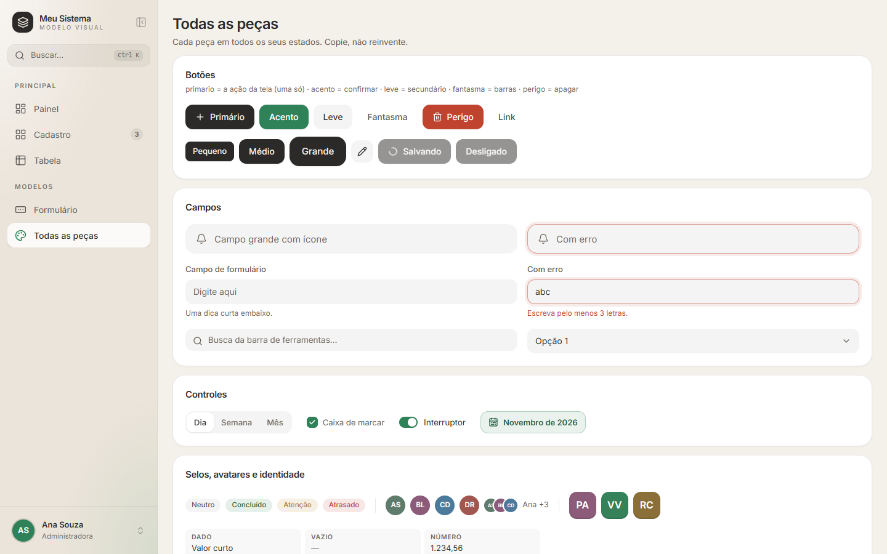

## Do Qt para cá

| No Qt era | Aqui é | Observação |
|---|---|---|
| `QPushButton` | `Botao` | Escolha a `variante` pela importância, não pela cor. |
| `QToolButton` só com ícone | `Botao tamanho="icone"` | Sempre com `aria-label`. |
| `QLineEdit` (formulário) | `CampoRotulado` | Rótulo em cima, dica/erro embaixo. |
| `QLineEdit` grande / de login | `Campo` | Com ícone. |
| `QLineEdit` de filtro na barra | `CampoBusca` | |
| `QTextEdit` / `QPlainTextEdit` | `AreaTexto` | |
| `QComboBox` | `Escolha` | Muitos itens: `buscavel`. |
| `QListWidget` com marcação múltipla | `Lista multipla` | |
| `QCheckBox` | `CaixaSelecao` | Preferência liga/desliga: `Interruptor`. |
| `QRadioButton` em grupo | `Segmentado` | 2–4 opções. Mais que isso: `Escolha`. |
| `QDateEdit` / `QCalendarWidget` | `SeletorData` | |
| `QTimeEdit` | `SeletorHora` | |
| Combo de mês/ano | `SeletorMes` (barra) ou `GradeMeses` (dentro de caixa) | |
| `QMessageBox.question` / `warning` "tem certeza?" | `confirmar()` | `Confirmacao` quando o estado já está na tela. |
| `QMessageBox.information` / `critical` | balão (`toast.*`, `avisar()`) | Erro do Python vira balão sozinho. |
| `QDialog` | `Dialogo` | |
| `QDockWidget` / painel lateral de detalhes | `Gaveta` | A "ficha". |
| `QTableWidget` / `QTableView` | Tabela densa (`telas/Tabela.tsx`) ou lista (`telas/Lista.tsx`) | Ver [09-telas.md](09-telas.md). |
| `QToolTip` / `setToolTip` | `Dica` | Ou `title` simples em texto truncado. |
| `QMenu` (botão «…» ou contexto) | `MenuSuspenso` + `ItemMenu` + `Divisoria` | |
| `QProgressBar` sem fim definido | `BarraOcupada` | |
| `QProgressBar` com valor | `BarraPartes` | |
| Mensagens na `QStatusBar` | balão (`toast`) | Não há barra de status. |
| `QTabWidget` | `Segmentado` (abas curtas na mesma tela) ou telas separadas no menu | |
| `QLabel` "rótulo: valor" em ficha | `Dado` | |
| `QGroupBox` | `TituloGrupo` + grade | |
| `QSplashScreen` / "carregando..." | `Esqueleto` | |

## Botões

### `Botao`

Arquivo: `componentes/ui/botao.tsx`. Aceita todas as props de `<button>`, mais:

| Prop | Valores | Padrão |
|---|---|---|
| `variante` | `"primario"` · `"acento"` · `"leve"` · `"fantasma"` · `"perigo"` · `"link"` | `"primario"` |
| `tamanho` | `"p"` (h-8, 13 px, `rounded-lg`) · `"m"` (h-10, 14 px, `rounded-xl`) · `"g"` (h-12, 15 px, `rounded-2xl`) · `"icone"` (`size-9`, `rounded-xl`) | `"m"` |
| `carregando` | `boolean`: mostra o giro (`Loader2`) e desliga o botão | — |
| `asChild` | `boolean`: o botão "veste" o filho (Radix Slot) | — |

| Variante | Quando usar |
|---|---|
| `primario` | **A** ação da tela (uma só): "Novo", "Entrar", "Editar" na ficha. Fundo `--primario`. |
| `acento` | Confirmar/salvar dentro de formulário e janela. Fundo `--acento`, texto `text-sobre-acento`. |
| `leve` | Secundária: "Cancelar", "Relatório", botões de catálogo. Fundo `bg-campo`. |
| `fantasma` | Terciária, em barras e listas: só texto, fundo aparece no hover. |
| `perigo` | Apagar de verdade (dentro da confirmação). |
| `link` | Ação em linha de texto. Sem altura fixa. |

Estados: hover (`brightness-110` / `bg-borda` / `bg-campo`), clique afunda
(`active:scale-[0.97]`), foco por teclado `ring-4 ring-acento/25`, desligado `opacity-50` e
sem clique. Ícone dentro: `className="size-4"`, antes do texto (o `gap-2` já separa).

Não use: `disabled` para dizer "você não pode". Regra do kit: botão que não pode ser usado
**não trava em silêncio**. Deixe ligado e, ao clicar, explique com `avisar("motivo")`. Use
`disabled` só quando o motivo é óbvio na tela (ex.: enquanto salva, via `carregando`).

Na barra de ferramentas, ajuste a altura para 36 px: `className="h-9"`.

```tsx
<Botao className="h-9" onClick={aoNovo}><Plus className="size-4" /> Novo</Botao>
<Botao variante="leve" onClick={aoVoltar}>Cancelar</Botao>
<Botao type="submit" variante="acento" carregando={formState.isSubmitting}>Salvar</Botao>
<Botao tamanho="icone" variante="leve" aria-label="Editar"><Pencil className="size-4" /></Botao>
```

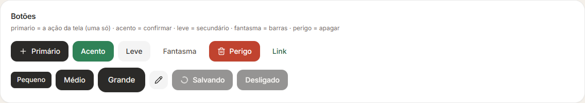
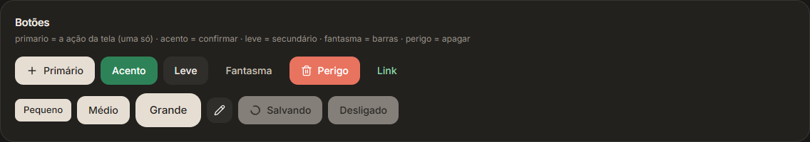

## Campos

Arquivo de todos: `componentes/ui/campo.tsx`.

### `Campo` (grande, com ícone)

Quando: tela de entrada e campos de destaque. Não use em formulário comum (use `CampoRotulado`).

| Prop | Tipo |
|---|---|
| `icone` | ícone do Lucide (`User`, `KeyRound`...) |
| `realce` | `boolean`: borda e ícone em acento (ex.: usuário reconhecido) |
| `erro` | `boolean`: borda e anel vermelhos |
| `fim` | `ReactNode` no fim do campo (ex.: o olho de mostrar a senha) |
| + props de `<input>` e `ref` | |

Anatomia: `h-12`, `rounded-2xl`, fundo `bg-campo`, borda transparente, ícone 18 px `text-texto-3`
(vira acento no foco), texto 15 px. Foco: `border-acento/50 bg-superficie ring-4 ring-acento/15`.
Erro: `border-perigo/50 ring-4 ring-perigo/10`.

```tsx
<Campo icone={User} placeholder="Usuário" value={login} onChange={(e) => setLogin(e.target.value)} realce={!!nome} erro={erro && !login.trim()} />
```

### `CampoRotulado` (formulário)

Quando: todo campo de texto de formulário e de diálogo.

| Prop | Tipo |
|---|---|
| `rotulo` | `string` (obrigatório) |
| `dica` | `string`: texto de ajuda embaixo (12 px, `text-texto-3`) |
| `erro` | `string`: troca a dica pelo erro em vermelho e marca `aria-invalid` |
| + props de `<input>` e `ref` | funciona direto com `register()` do React Hook Form |

Anatomia: rótulo 13 px `font-medium text-texto-2`, `gap-1.5`, campo `h-10 rounded-xl px-3`
14 px. Foco igual ao `Campo`. Somente leitura (`readOnly`): `opacity-60`.

```tsx
<CampoRotulado rotulo="Código" placeholder="0000-0" dica="Quatro números, traço e um número."
  erro={e.codigo?.message} {...register("codigo")} />
```

### `AreaTexto`

Quando: texto longo (observação). Mesmo visual do `CampoRotulado`, `min-h-24`, redimensiona na
vertical. Props: `rotulo` (obrigatório) + props de `<textarea>` e `ref`. **Não tem** `dica` nem
`erro`; se precisar, coloque embaixo `<span className="mt-1.5 block text-[12px] text-perigo">`.

```tsx
<AreaTexto rotulo="Observação" placeholder="Opcional" {...register("observacao")} />
```

### `CampoBusca` (barra de ferramentas)

Quando: filtrar a lista da tela. Lupa à esquerda, X para limpar quando há texto. `h-9`,
13.5 px, `flex-1` com mínimo de 200 px. Não é para formulário.

| Prop | Tipo |
|---|---|
| `valor`, `aoMudar` | `string`, `(v: string) => void` |
| `placeholder` | padrão `"Buscar…"` |
| `className` | ex.: `"ml-2"`, `"max-w-md"` |

```tsx
<CampoBusca valor={busca} aoMudar={setBusca} placeholder="Buscar por nome, código…" className="ml-2" />
```

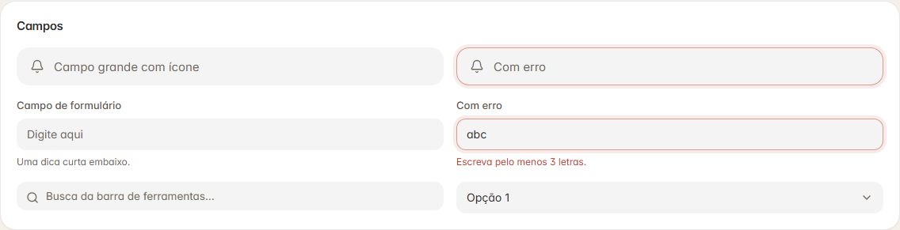
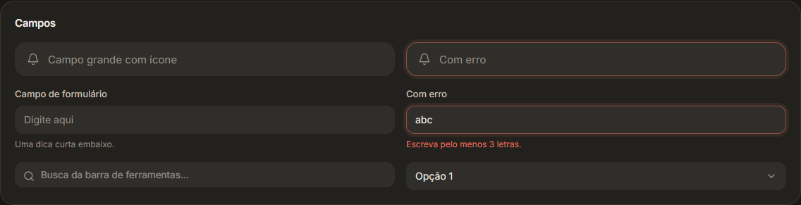

## Escolher

### `Lista` e `Escolha`

Arquivo: `componentes/ui/lista.tsx`. Lista suspensa no visual do sistema, no lugar do `<select>`.
Atenção: a **peça** `Lista` (`componentes/ui/lista.tsx`) não é a **tela** `Lista`
(`telas/Lista.tsx`).

`Lista` (vários valores):

| Prop | Tipo | Padrão |
|---|---|---|
| `rotulo` | `string` (obrigatório; vazio = sem rótulo) | — |
| `itens` | `{ valor, rotulo, detalhe? }[]` (`ItemLista<T>`) | — |
| `valor` | `T[]` | — |
| `aoMudar` | `(v: T[]) => void` | — |
| `multipla` | marca vários; a lista fica aberta enquanto marca | `false` |
| `buscavel` | campo "Procurar…" no topo (sem acento, sem maiúscula) | `false` |
| `compacto` | `h-9` e 13 px, para formulário denso | `false` |
| `vazio` | texto quando nada escolhido | `"Escolher…"` |
| `semItens` | texto quando a lista está vazia | `"Nada para escolher."` |
| `classe` | classes do bloco todo (**`classe`, não `className`**) | — |

`Escolha` (um valor só, o caso comum): mesmas props, mas `valor: T`, `aoMudar: (v: T) => void`,
`rotulo` opcional, sem `multipla`.

Anatomia: gatilho `h-10 rounded-xl bg-campo`, seta que gira ao abrir; aberto ganha
`border-acento/50 ring-4 ring-acento/15`. Caixa: `rounded-2xl border-borda bg-superficie p-1.5 shadow-pop`,
até 280 px de altura com rolagem, pelo menos a largura do gatilho. Item escolhido: check em
acento (única) ou caixinha cheia de acento (múltipla).

```tsx
<Escolha valor={field.value} aoMudar={field.onChange}
  itens={["Categoria A", "Categoria B", "Categoria C"].map((c) => ({ valor: c, rotulo: c }))} />
<Lista rotulo="Equipe" multipla buscavel itens={pessoas.map((p) => ({ valor: p, rotulo: p }))}
  valor={field.value} aoMudar={field.onChange} />
```

Sem foto própria aberta; o gatilho aparece em `../imagens/claro/peca-campos.png` e em
`../imagens/claro/formulario.png`.

### `CaixaSelecao`

Arquivo: `componentes/ui/marcadores.tsx`. Caixa de marcar 18 px, cantos de 6 px; marcada enche
de acento com o check em `text-sobre-acento`. Foco `ring-4 ring-acento/20`. Rótulo 13 px
`text-texto-2`, clicável.

Props: `rotulo` (string), `marcado` (boolean), `aoMudar(v: boolean)`, `className`.
Quando: sim/não dentro de formulário ou lista. Para preferência que vale na hora, use `Interruptor`.

```tsx
<CaixaSelecao rotulo="Avisar a equipe por e-mail" marcado={field.value} aoMudar={field.onChange} />
```

### `Interruptor`

Arquivo: `componentes/ui/marcadores.tsx`. Liga/desliga estilo iOS: trilho 30 × 18 px
(`bg-acento` ligado, `bg-borda` desligado), bolinha branca de 14 px que desliza. `role="switch"`.

Props: `ligado` (boolean), `aoMudar(v: boolean)`, `rotulo?` (string). Quando: preferência ou
estado "ativo/inativo". Não use para escolher entre opções com nome (use `Segmentado`).

```tsx
<Interruptor rotulo="Ativo" ligado={field.value} aoMudar={field.onChange} />
```

### `Segmentado`

Arquivo: `componentes/ui/marcadores.tsx`. Controle segmentado estilo macOS: a pílula branca
**desliza** até a opção escolhida (`layoutId`, mola `MOLA_RAPIDA`).

Props: `valor: T`, `opcoes: [T, ReactNode][]` (valor e rótulo, que pode ser ícone),
`aoMudar(v: T)`. Anatomia: trilho `h-9 rounded-xl bg-campo p-0.5`; opção `h-8 rounded-[calc(var(--raio-m)-2px)] px-3`
13 px `font-medium`; escolhida `text-texto` sobre pílula `bg-superficie shadow-sm`; as outras
`text-texto-3`.

Quando: 2–4 opções exclusivas e curtas (Todos/Em aberto, Cartões/Lista, Dia/Semana/Mês).
Não use com mais de 4 opções ou rótulos longos (use `Escolha`). Cada `Segmentado` tem a sua pílula (`layoutId` vem de `useId()`), então
vários na mesma tela não se misturam.

```tsx
<Segmentado valor={filtro} opcoes={[["todos", "Todos"], ["abertos", "Em aberto"]]} aoMudar={setFiltro} />
<Segmentado valor={modo} opcoes={[["cartoes", <LayoutGrid key="g" className="size-4" />], ["lista", <List key="l" className="size-4" />]]} aoMudar={setModo} />
```

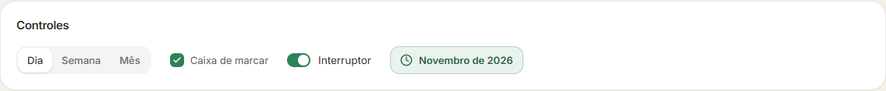
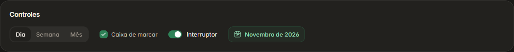

### `SeletorData` e `SeletorHora`

Arquivo: `componentes/ui/seletor-data.tsx`. No lugar do calendário do Windows.

`SeletorData`:

| Prop | Tipo | Padrão |
|---|---|---|
| `rotulo` | `string` | — |
| `valor` | `"AAAA-MM-DD"` ou `""` | — |
| `aoMudar` | `(v: string) => void` (`""` = limpou) | — |
| `vazio` | texto sem data | `"Sem prazo"` |
| `desligado` | `boolean`: não abre | — |
| `motivo` | `string`: com `desligado`, o balão que explica ao clicar | — |
| `titulo` | `string`: `title` do bloco | — |
| `gatilho` | `ReactNode`: botão próprio no lugar do campo com rótulo | — |

Anatomia: campo `h-10` com ícone de calendário (acento quando há data), data por extenso
("sex, 17 de outubro de 2026", função `dataPorExtenso`), X para limpar ao passar o mouse.
Caixa de 300 px: mês/ano com setas, semana começando na **segunda**, 6 linhas fixas, dia `h-9
rounded-xl`; hoje com pontinho de acento; escolhido `bg-acento text-sobre-acento`; atalhos
"Hoje", "Amanhã", "Em 7 dias" e "Limpar".

`SeletorHora`: props `rotulo`, `valor` (`"HH:MM"` ou `""`), `aoMudar`, `desligado`, `titulo`,
`motivo`. Caixa de 296 px: horas 07h–21h em grade de 5, minutos `:00 :15 :30 :45` (liberados
depois de escolher a hora), e "Outro horário" que aceita `9`, `930`, `9:30`, `9h30`, `1745`
(inválido → `avisar(...)`). Sempre 24 h.

```tsx
<Controller control={control} name="prazo" render={({ field }) => <SeletorData rotulo="Prazo" valor={field.value} aoMudar={field.onChange} />} />
<Controller control={control} name="hora" render={({ field }) => <SeletorHora rotulo="Hora" valor={field.value} aoMudar={field.onChange} />} />
<SeletorData rotulo="Entrega" valor={v} aoMudar={setV} desligado motivo="Só quem criou pode mudar a data." />
```

Sem foto aberta; o campo aparece em `../imagens/claro/formulario.png`.

### `SeletorMes` e `GradeMeses`

Arquivo: `componentes/ui/seletor-mes.tsx`.

`SeletorMes` é o botão de mês da **barra de ferramentas** (`h-9`). Props: `valor` (`"AAAA-MM"`),
`atual` (o mês de hoje, `mesAtual()` de `lib/datas.ts`), `aoMudar(c)`. Mostra "Novembro de 2026".
No mês atual fica em acento; em outro mês fica âmbar (`alerta`) como aviso visual, sem bloquear
nada, e a caixa ganha "Voltar para <mês atual>".

`GradeMeses` é só a grade 4 × 3 (264 px) com troca de ano. Props: `valor`, `aoEscolher(c)`. Use
dentro de outra caixa.

```tsx
<SeletorMes valor={mes} atual={mesAtual()} aoMudar={setMes} />
```

Imagem: o botão aparece em `../imagens/claro/peca-controles.png` e `../imagens/claro/painel.png`.

## Janelas

Arquivo: `componentes/ui/dialogo.tsx` (e `lib/confirmar.tsx`).

### `Dialogo`

Janela por cima da tela, estilo folha do macOS: fundo escurece e desfoca (`bg-black/30 backdrop-blur-sm`),
a janela entra crescendo de 94% com mola (`MOLA_JANELA`). Esc, clique fora e o X fecham.

| Prop | Tipo | Padrão |
|---|---|---|
| `aberto` | `boolean` | — |
| `aoFechar` | `() => void` | — |
| `titulo` | `string` (19 px semibold) | — |
| `descricao` | `ReactNode` (14 px `text-texto-2`, respeita quebras de linha) | — |
| `largura` | classe de largura máxima | `"max-w-md"` |
| `children` | conteúdo; botões no fim em `flex justify-end gap-2` | — |

Anatomia: `rounded-janela border-borda bg-superficie p-7 shadow-janela`, até a altura da janela
menos 32 px (rola por dentro). Botões: `leve` (cancelar) à esquerda, `acento` (confirmar) à direita.

Quando: tarefa curta que precisa de foco (editar um campo, escolher algo). Não use para mostrar
detalhes de um item (use `Gaveta`) nem para formulário grande (use uma tela).

```tsx
<Dialogo aberto={aberto} aoFechar={() => setAberto(false)} titulo="Título da janela" descricao="Uma frase que explica o que esta janela faz.">
  <div className="flex flex-col gap-3">
    <CampoRotulado rotulo="Campo" placeholder="Digite" />
    <div className="flex justify-end gap-2">
      <Botao variante="leve" onClick={() => setAberto(false)}>Cancelar</Botao>
      <Botao variante="acento" onClick={salvar}>Salvar</Botao>
    </div>
  </div>
</Dialogo>
```

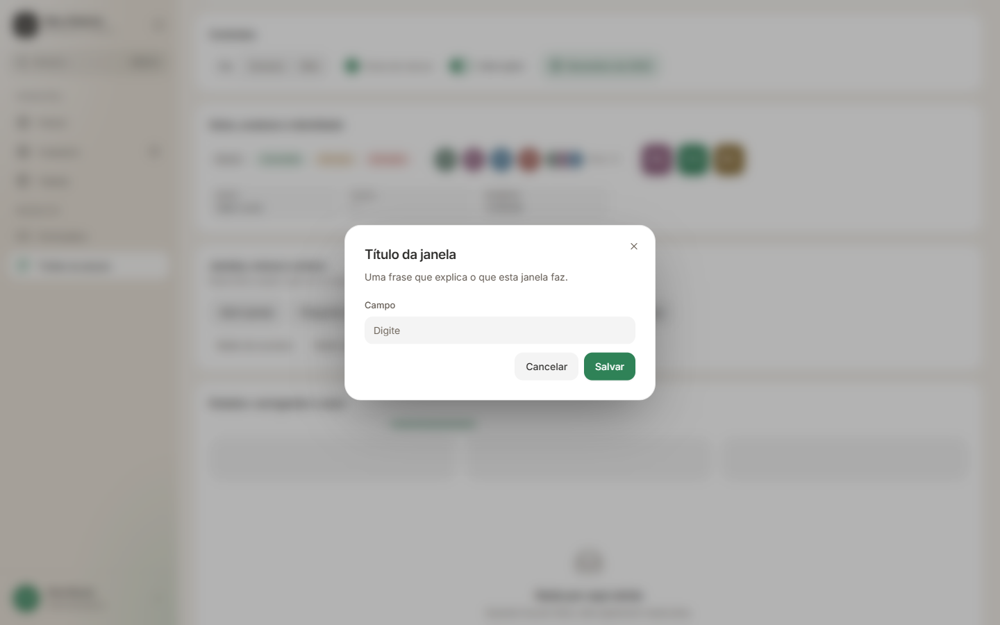
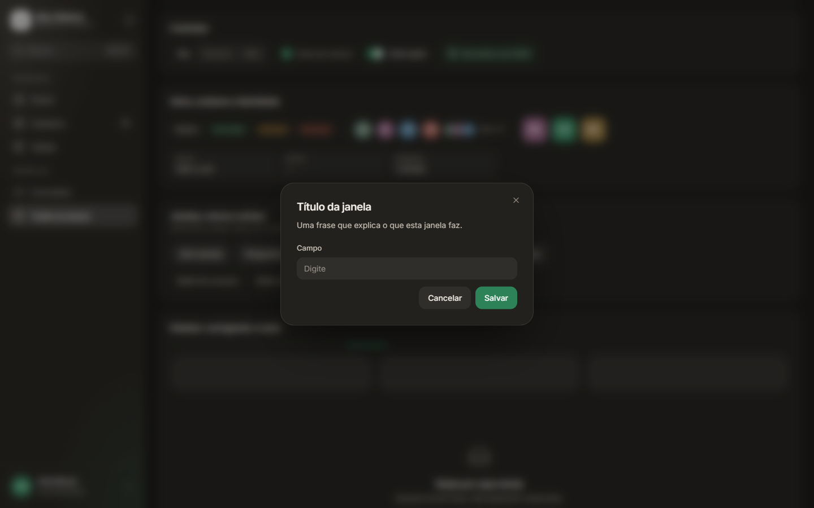

### `confirmar()` (o mais usado)

Arquivo: `lib/confirmar.tsx`. "Tem certeza?" chamado de qualquer lugar, sem estado na tela.
Devolve `Promise<boolean>`. **Enter confirma, Esc cancela**; o foco começa no botão de confirmar.

| Campo | Tipo | Padrão |
|---|---|---|
| `titulo` | `string` | — |
| `texto` | `string` (opcional) | — |
| `botao` | texto do botão de confirmar | `"Confirmar"` |
| `perigo` | botão vermelho (`perigo`); `false` = acento | **`true`** |

```tsx
if (await confirmar({ titulo: "Apagar este item?", texto: "Ele sai da lista e não dá para desfazer.", botao: "Apagar" })) {
  apagar.mutate(id);
}
if (await confirmar({ titulo: "Enviar agora?", botao: "Enviar", perigo: false })) enviar();
```

### `Confirmacao`

A mesma pergunta como componente, quando o estado de aberto já vive na tela.

Props: `aberto`, `titulo`, `texto` (`ReactNode`, obrigatório), `sim` (texto do botão),
`nao` (padrão `"Cancelar"`), `perigoso` (boolean), `aoResponder(sim: boolean)`. Largura 400 px.
Aqui o foco começa em **"Cancelar"** e não há atalho Enter.

```tsx
<Confirmacao aberto={pergunta} titulo="Apagar este item?" texto="Ele sai da lista e não dá para desfazer."
  sim="Apagar" perigoso aoResponder={(sim) => { setPergunta(false); if (sim) apagar(); }} />
```

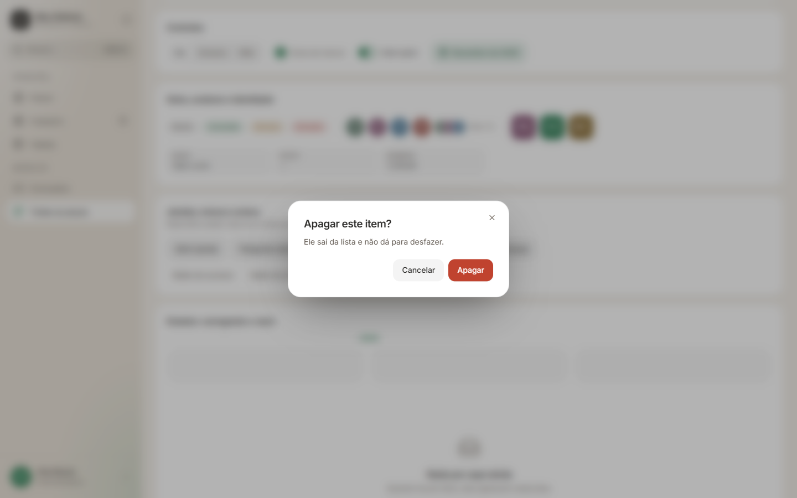
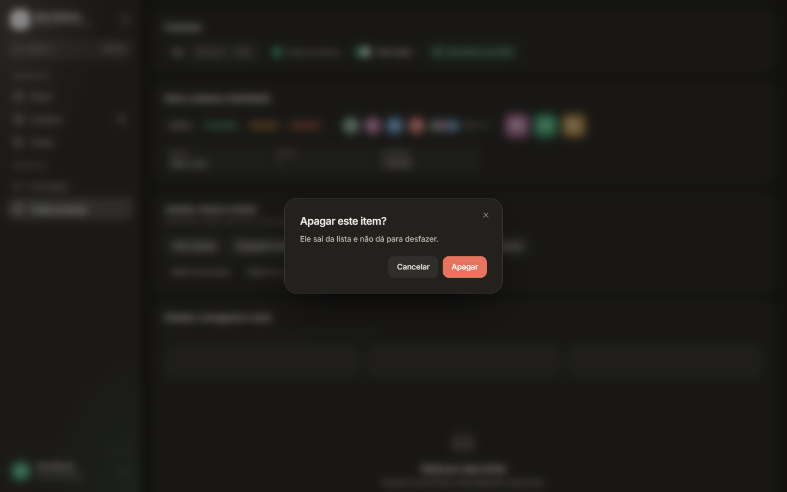

### `Gaveta` (ficha lateral)

Desliza da direita (Vaul), flutuando a 8 px das bordas, cantos `rounded-janela`, 460 px de
largura. Arrastar para a direita, Esc ou clique fora fecham.

| Prop | Tipo |
|---|---|
| `aberto`, `aoFechar` | `boolean`, `() => void` |
| `titulo` | `string`. Com `cabecalho`, o título fica só para leitor de tela. |
| `cabecalho` | `ReactNode` no topo (ícone grande, nome, selos) |
| `rodape` | `ReactNode`: ações fixas embaixo (`flex gap-2`, borda em cima) |
| `cor` | cor de identidade do item: véu degradê no topo. Hex (`corPorTexto()`) ou `var(--g-1)`: o véu é feito com `color-mix` a 13%. |
| `children` | corpo que rola (`px-6 py-5`) |

Quando: ver e agir sobre **um item** sem sair da lista (o "duplo clique abre detalhes" do Qt).
Não use para criar item novo com muitos campos (use a tela de formulário).

```tsx
<Gaveta aberto={!!i} aoFechar={() => setAberto(null)} titulo={i?.nome ?? ""} cor={i ? corPorTexto(i.nome) : undefined}
  cabecalho={i && <div className="flex items-start gap-4 pr-8"><IconeApp nome={i.nome} tamanho={60} />...</div>}
  rodape={<><Botao className="flex-1" onClick={editar}><Pencil className="size-4" /> Editar</Botao>
           <Botao variante="leve" className="text-perigo" onClick={apagar}><Trash2 className="size-4" /> Apagar</Botao></>}>
  <TituloGrupo>Dados</TituloGrupo>
  <div className="grid grid-cols-2 gap-1.5"><Dado rotulo="Cidade" valor={i.cidade} copiavel /></div>
</Gaveta>
```

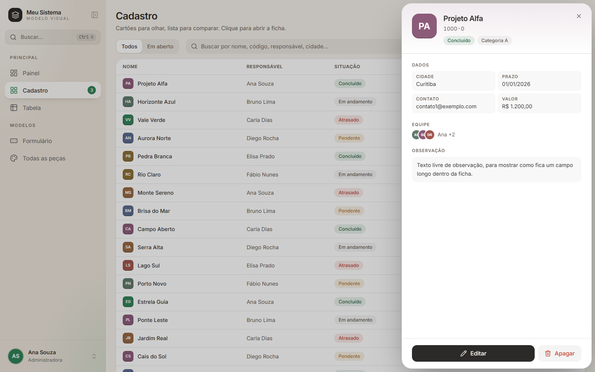
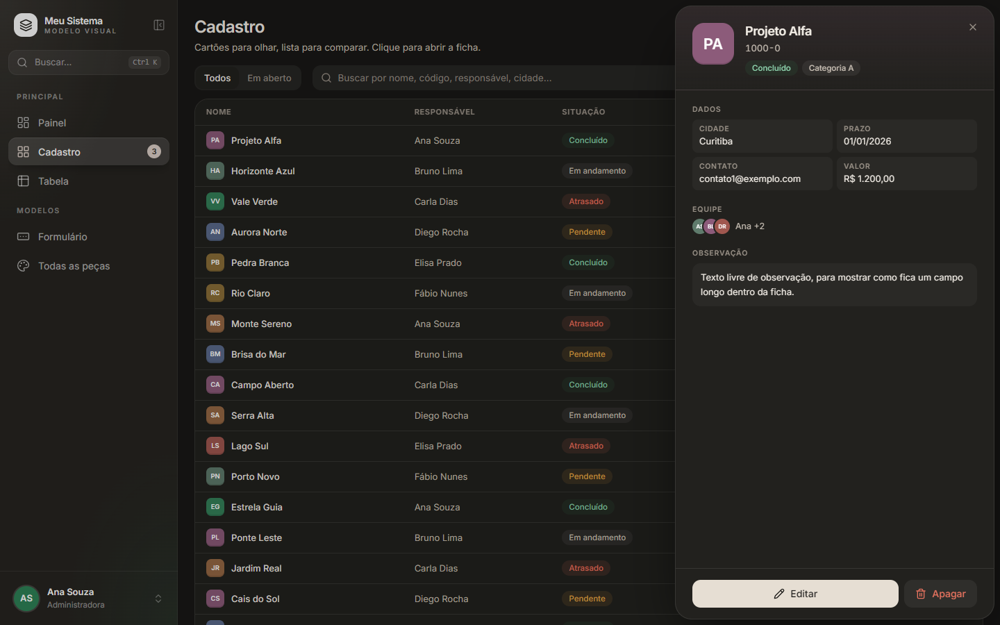

## Identidade e dados

Arquivo de todos: `componentes/ui/pecas.tsx`.

### `Selo`

Pílula de situação: `h-[22px] rounded-full px-2.5`, 11.5 px `font-medium`, fundo da cor a 12% e
texto na cor. Props: `children`, `tom` (`"neutro"` padrão · `"acento"` · `"alerta"` · `"perigo"`),
`className`. Quando: situação de um item (concluído, atrasado). Não use como botão.

```tsx
<Selo tom="perigo">Atrasado</Selo>
<Selo>{i.categoria}</Selo>
```

### `Avatar`

Bolinha com foto ou iniciais, numa cor **fixa por nome** (`corPorTexto`), letra branca.
Props: `nome` (string), `foto?` (endereço), `tamanho` (px, padrão 32), `anel?` (borda da cor da
superfície, para empilhar com `-space-x-1`), `className`. Abaixo de 22 px mostra só uma letra.

```tsx
<Avatar nome="Nome Sobrenome" />
<span className="flex -space-x-2">{nomes.map((n) => <Avatar key={n} nome={n} tamanho={30} anel />)}</span>
```

### `Pessoas`

Até 3 avatares de 22 px empilhados + o primeiro nome + "+N". Nome completo de todos no `title`.
Prop: `nomes: string[]`. Quando: responsável/equipe em cartão, lista e ficha.

```tsx
<Pessoas nomes={[i.responsavel, ...i.equipe]} />
```

### `IconeApp`

Quadrado com cantos de 28% e duas letras (palavras com mais de 2 letras ou com número), na cor
fixa do nome. É a identidade visual de cada item da lista. Props: `nome`, `tamanho` (padrão 44),
`cor?` (substitui a cor automática). Tamanhos usados: 26 (linha de lista), 40 (cartão), 60 (ficha).

```tsx
<IconeApp nome={i.nome} tamanho={40} />
```

### `Dado`

Rótulo pequeno em caixa alta (10.5 px, `tracking-[0.06em]`, `text-texto-3`) em cima, valor
13 px embaixo, num bloco `rounded-lg bg-campo/60 px-2.5 py-1.5`. Valor vazio vira "—".
Props: `rotulo`, `valor` (**string**), `copiavel?` (mostra o `BotaoCopiar` no hover).
Quando: dados de leitura em fichas e cartões, em grade `grid grid-cols-2 gap-1.5`.

```tsx
<Dado rotulo="Contato" valor={i.contato} copiavel />
```

### `BotaoCopiar`

Ícone de copiar 20 px que aparece **só com o mouse em cima** do bloco pai que tenha a classe
`group/item` (o `Dado` já tem). Copia e mostra o balão "Copiado." (ou erro). Prop: `texto`.

```tsx
<div className="group/item flex items-center gap-1.5">{codigo}<BotaoCopiar texto={codigo} /></div>
```

### `TituloGrupo`

Título de grupo em fichas, formulários e menus: 10.5 px, caixa alta, `tracking-[0.08em]`,
`text-texto-3`, `mb-1.5`. Prop: `children`.

```tsx
<TituloGrupo>Identificação</TituloGrupo>
```

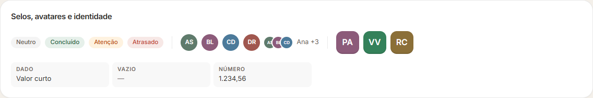
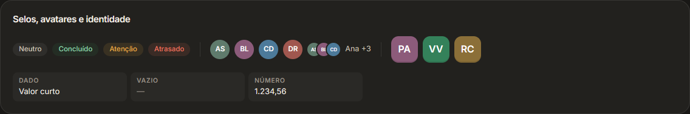

## Menus e dicas

### `Dica`

Tooltip invertido (fundo `texto`, letra `superficie`: escuro no tema claro, claro no escuro) com setinha (Radix). Props: `texto`, `lado` (`"top"` padrão · `"right"` ·
`"bottom"` · `"left"`), `children` (**um** elemento, que recebe o gatilho). Atraso de 250 ms
(o `Tooltip.Provider` está no `main.tsx`). Quando: botão só de ícone, abreviação. Não use para
texto importante (ninguém passa o mouse em tudo).

```tsx
<Dica texto="Uma dica curta"><Botao variante="leve">Passe o mouse</Botao></Dica>
```

### `MenuSuspenso`, `ItemMenu`, `Divisoria`

O «…» da barra e menus de ações. Caixa `w-56 rounded-2xl border-borda bg-superficie p-1.5 shadow-pop`.

| Peça | Props |
|---|---|
| `MenuSuspenso` | `gatilho` (um elemento), `children`, `alinhar` (`"end"` padrão · `"start"`) |
| `ItemMenu` | `icone` (Lucide), `texto`, `perigo?` (vermelho), `aoClicar`. `h-9 rounded-xl`, 13.5 px, hover `bg-campo`. Fecha o menu ao clicar. |
| `Divisoria` | sem props: linha de 1 px `bg-borda my-1` |

Ação perigosa vai por último, depois de uma `Divisoria`, e confirma com `confirmar()`.

```tsx
<MenuSuspenso gatilho={<button aria-label="Mais ações" className="flex size-9 items-center justify-center rounded-xl bg-campo text-texto-2 transition hover:text-texto data-[state=open]:text-texto"><MoreHorizontal className="size-[18px]" /></button>}>
  <ItemMenu icone={Download} texto="Importar planilha" aoClicar={importar} />
  <Divisoria />
  <ItemMenu icone={Trash2} texto="Apagar" perigo aoClicar={apagar} />
</MenuSuspenso>
```

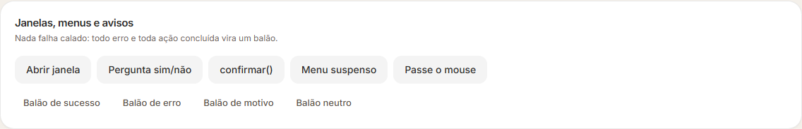
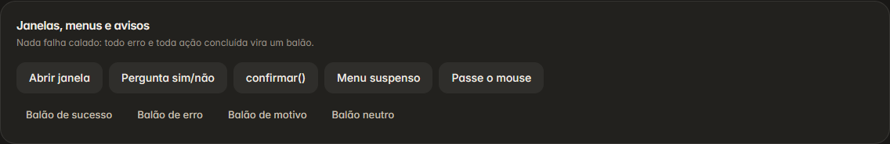

## Estados da tela

### `Vazio`

Ícone fino grande (40 px, traço 1.4), frase em negrito 16 px, explicação 13 px e, se houver, o
botão que resolve (`leve`, pequeno). Props: `icone`, `titulo`, `texto`, `acao?: { texto, aoClicar }`.
Quando: lista sem itens ou busca sem resultado. Sempre diga **o que fazer**.

```tsx
<Vazio icone={SearchX} titulo={`Nada encontrado para «${busca}»`} texto="Confira a escrita, ou limpe a busca para ver todos."
  acao={{ texto: "Limpar busca", aoClicar: () => setBusca("") }} />
```

### `Esqueleto`

Blocos pulsando no formato do que vai chegar (grade de cartões de 320 px). Props: `quantos`
(padrão 6), `altura` (px, padrão 180), `className`. Quando: primeira carga (`q.isLoading`). Não
use giro solto no meio da tela.

```tsx
{q.isLoading ? <Esqueleto /> : ...}
```

### `BarraOcupada`

Barra fina (4 px) com um pedaço de acento indo e vindo: trabalho sem saber quanto falta
(importar, gerar arquivo). Prop: `className` (ex.: `"max-w-sm"`).

```tsx
{importando && <BarraOcupada className="max-w-sm" />}
```

### `AvisoErro`

Erro no fim do formulário: caixa `rounded-xl bg-perigo/10 text-perigo` 13 px, `role="alert"`.
Ao aparecer, **rola até ele e repete num balão**. Texto vazio = não mostra nada. Props: `texto`,
`className`.

```tsx
<AvisoErro texto={erroGeral} className="mt-5" />
```

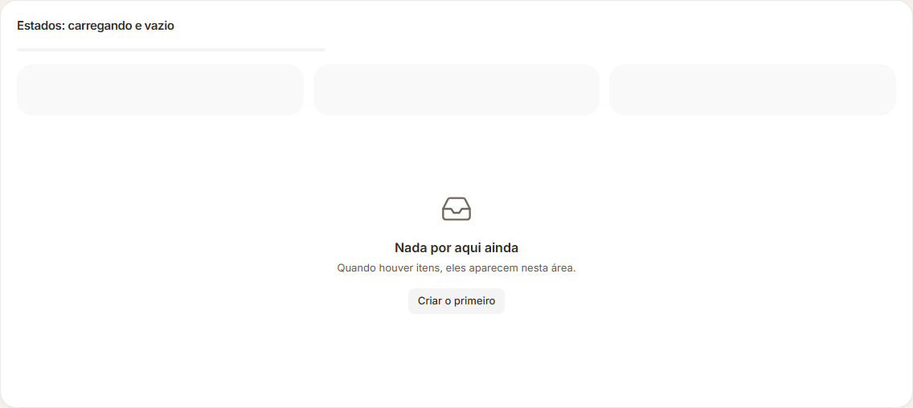
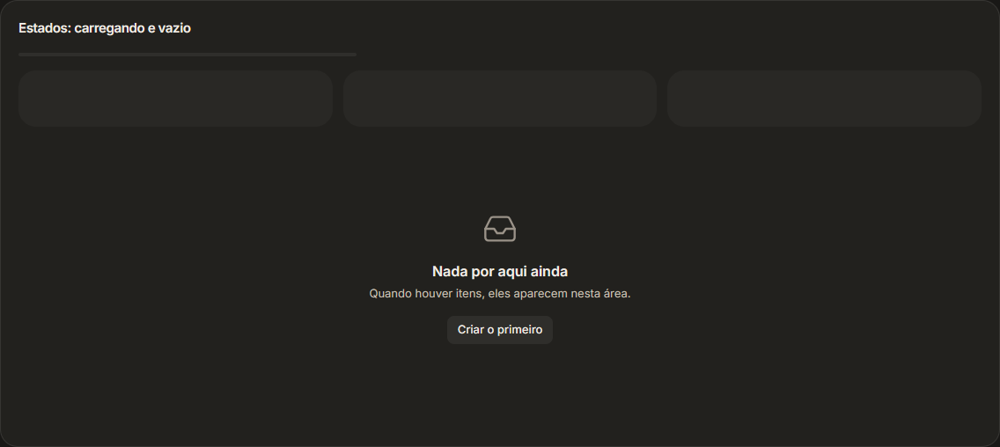

### `useJanelaEstreita(limite)`

Gancho em `pecas.tsx`: `true` enquanto a janela tem menos de `limite` px. O menu lateral usa
`useJanelaEstreita(1100)` para ligar o modo automático.

## Balões (toasts)

Biblioteca Sonner. O `<Toaster>` fica em `src/main.tsx`: no **topo, ao centro**, cores ricas,
botão de fechar, cantos de 16 px, fonte do sistema. Regra: **nada falha calado**; toda ação
concluída e todo erro viram balão.

| Chamada | Quando |
|---|---|
| `toast.success("Salvo.")` | Ação concluída. |
| `toast.error("Não foi possível salvar: <motivo>.")` | Falha. (Erros do Python já viram balão sozinhos; ver [04-arquitetura.md](04-arquitetura.md).) |
| `avisar("Só quem criou pode apagar este item.")` | "Não pode" com o motivo (`lib/avisos.ts`, amarelo, `id` = texto para não repetir). |
| `toast("Informação neutra.")` | Informação. |
| `copiarTexto(texto, "Copiado.")` | Copiar para a área de transferência, sempre contando se deu certo (`lib/avisos.ts`). |

```tsx
import { toast } from "sonner";
import { avisar } from "@/lib/avisos";
```

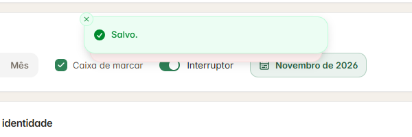
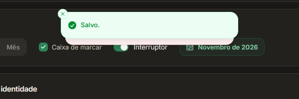

## Gráficos (CSS puro)

Arquivo: `componentes/graficos/graficos.tsx`. Sem biblioteca: seguem o tema sozinhos. As cores
vêm das props `cor`, sempre um `var(--g-N)` com o significado fixo
([07-cores-e-medidas.md](07-cores-e-medidas.md)). Auxiliar: `pct(a, b)` = porcentagem inteira
(0 se `b` for 0).

### `Painel` (cartão de gráfico)

Anatomia fixa: **título · o que mede · legenda · gráfico · leitura**. Props: `titulo`,
`mede` (frase do que o gráfico mede), `legenda?` (use `Chave`), `leitura?` (a frase que
**interpreta** o gráfico, no rodapé com borda), `acao?` (botão no canto), `children`, `className`
(`"h-full"` para igualar alturas na grade). Título 14.5 px, `px-5`.

Atenção ao nome: o cartão de gráfico se chama `Painel`, igual à tela `Painel`. Na tela, o
modelo importa como `Painel as Cartao`.

```tsx
<Cartao titulo="Por pessoa" mede="Itens de cada responsável, pela situação." leitura="Quem tem mais vermelho precisa de ajuda primeiro." className="h-full">
  <Barras itens={...} />
</Cartao>
```

### `Chave`

Quadradinho de cor + nome (+ número) da legenda. Props: `cor`, `texto`, `valor?`, `aoClicar?`
(clicável quando filtra algo).

```tsx
<Chave cor="var(--g-1)" texto="No prazo" valor={12} />
```

### `Indicador` e `FaixaIndicadores`

`Indicador`: número grande (28 px) + a referência que o torna legível ("de 18", "28%") + o que
significa. Props: `cor`, `rotulo`, `valor`, `referencia?`, `explica`, `alerta?` (número em
vermelho), `aoClicar?` (vira botão, com seta no hover; leva à lista filtrada).

`FaixaIndicadores`: junta os indicadores **num cartão só**, com divisórias de 1 px (2 colunas;
4 a partir de `@3xl`). Nada de caixinhas soltas.

```tsx
<FaixaIndicadores>
  <Indicador cor="var(--g-1)" rotulo="Concluídos" valor={5} referencia="de 18" explica="entregues neste mês" aoClicar={abrirConcluidos} />
  <Indicador cor="var(--g-3)" rotulo="Atrasados" valor={4} explica="passaram do prazo" alerta aoClicar={abrirAtrasados} />
</FaixaIndicadores>
```

### `BarraPartes`

Uma barra só, dividida em partes coloridas com 2 px de vão. Props: `partes: { valor, cor, nome? }[]`
(com `nome`, o `title` mostra valor e %), `altura` (px, padrão 10). Para progresso, complete com
uma parte `cor: "transparent"`.

```tsx
<BarraPartes partes={[{ valor: 64, cor: "var(--g-5)" }, { valor: 36, cor: "transparent" }]} altura={6} />
```

### `Rosca`

Rosca com `conic-gradient` e o número no meio. Props: `partes: { valor, cor }[]`, `centro`
(string, 22 px), `centroSub` (string, 10.5 px), `tamanho` (px, padrão 136).

```tsx
<Rosca partes={[{ valor: 5, cor: "var(--g-1)" }, { valor: 4, cor: "var(--g-3)" }]} centro="28%" centroSub="concluído" />
```

### `Barras`

Barras horizontais em colunas alinhadas: nome (38%) | barra | número (72 px). Props:
`itens: { nome, detalhe?, partes: { valor, cor }[], escala, valor, aoClicar? }[]`. `escala` é o
valor que enche a barra toda (use o maior da lista).

```tsx
<Barras itens={pessoas.map((p) => ({ nome: p.nome, detalhe: `${p.qtd} itens`, escala: maior, valor: `${p.pct}% feito`, partes: p.partes }))} />
```

### `Colunas`

Colunas lado a lado, empilhadas por cor, número em cima e rótulo embaixo (até 34 px de largura).
Props: `colunas: { rotulo, partes: { valor, cor, nome }[], fundo?, destaque? }[]`, `altura`
(px, padrão 132). `fundo` marca uma coluna (fim de semana); `destaque` põe o rótulo em negrito
(hoje). Coluna com total 0 mostra um tracinho.

```tsx
<Colunas colunas={dias.map((d) => ({ rotulo: d.dia, fundo: d.fimDeSemana, partes: [
  { nome: "No prazo", cor: "var(--g-1)", valor: d.noPrazo }, { nome: "Com atraso", cor: "var(--g-2)", valor: d.atraso }] }))} />
```

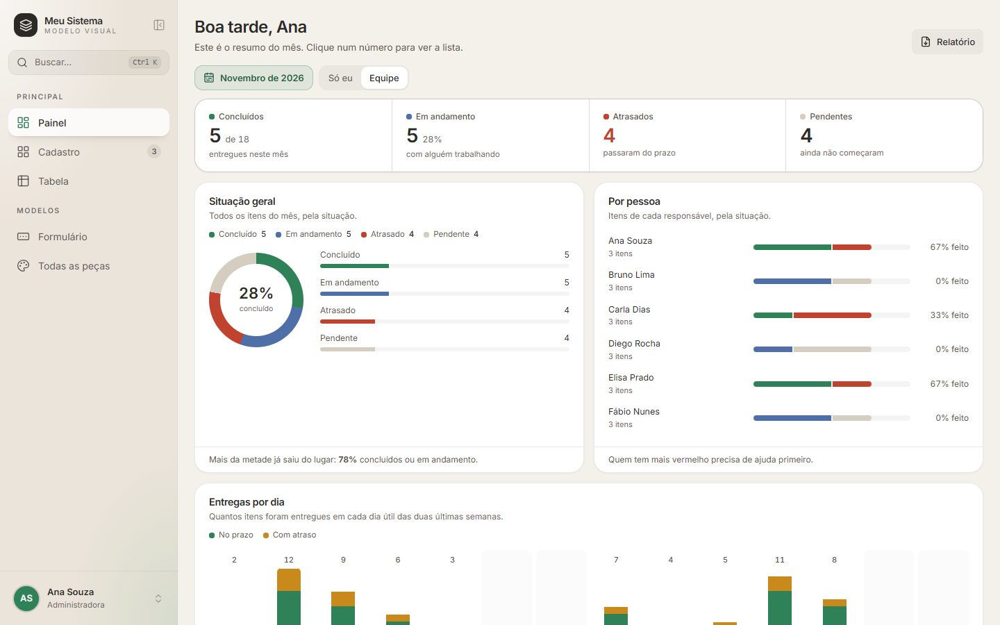
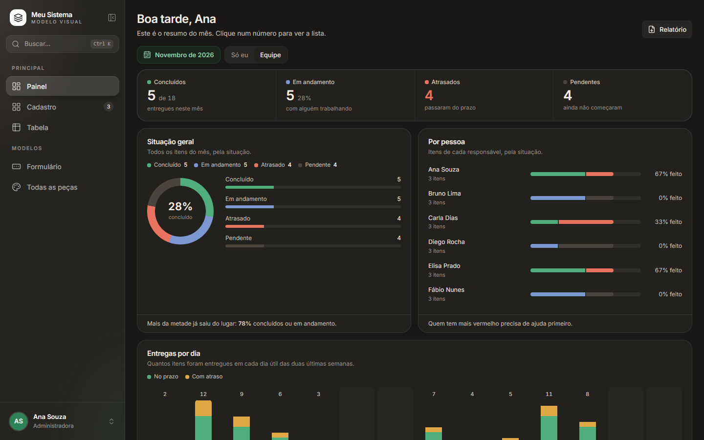

## Funções de apoio (`src/lib/`)

| Função | Arquivo | Faz |
|---|---|---|
| `cn(...classes)` | `utils.ts` | Junta classes sem conflito. Use sempre que aceitar `className`. |
| `iniciais(nome)` | `utils.ts` | "Nome Sobrenome" → "NS". |
| `corPorTexto(texto)` | `utils.ts` | Cor fixa (hex) por texto: o mesmo item tem sempre a mesma cor. |
| `semAcento(t)` | `utils.ts` | Para buscas: sem acento e sem maiúscula. |
| `plural(n, um, varios)` | `utils.ts` | "1 item", "2 itens". |
| `hojeIso()`, `mesAtual()`, `mesPorExtenso(c)`, `somarMeses(c, n)`, `MESES`, `MESES_CURTOS` | `datas.ts` | Datas no fuso do computador. |
| `avisar(texto)`, `copiarTexto(texto, sucesso?)` | `avisos.ts` | Balões (ver acima). |
| `confirmar(pedido)` | `confirmar.tsx` | "Tem certeza?" (ver acima). |
| `aplicarDesfoque(reduzir?)`, `desfoqueReduzido()` | `desfoque.ts` | "Reduzir desfoque". |
| `ligarBarraDiscreta()` | `rolagem.ts` | Barra de rolagem que só aparece rolando. |
