# 09 · Telas (modelos e como montar)

> **Para a IA.** Toda tela do programa da pessoa segue um destes modelos. Para cada tela antiga
> do Qt, escolha o modelo, copie o arquivo correspondente de `modelo/frontend/src/telas/` e troque
> dados, rótulos e ações. Não desenhe uma tela do zero.

Os nomes visíveis do modelo ("Meu Sistema", "Cadastro", "Painel", "Projeto Alfa", a saudação
com nome) são **exemplo**. Na cirurgia, nomes de telas, seções do menu, rótulos e cores vêm da
entrevista ([02-entrevista.md](02-entrevista.md)) e do programa antigo.

| Modelo | Arquivo | Para telas do tipo |
|---|---|---|
| Janela principal | `componentes/layout/JanelaPrincipal.tsx` | A moldura de todas as telas (menu + área). |
| Menu lateral | `componentes/layout/MenuLateral.tsx` + `telas.ts` | Navegação. |
| Busca Ctrl+K | `componentes/layout/BuscaRapida.tsx` | Ir a qualquer tela, ação ou item. |
| Cadastro (cartões/lista + ficha) | `telas/Lista.tsx` | Clientes, produtos, projetos: coisas com nome e detalhes. |
| Painel | `telas/Painel.tsx` | Tela inicial, resumo, indicadores. |
| Tabela densa | `telas/Tabela.tsx` | Muitas linhas e colunas, conferência, relatório na tela. |
| Formulário | `telas/Formulario.tsx` | Criar/editar com muitos campos. |
| Entrada | `telas/Entrada.tsx` | Login. |

## Como as telas são registradas

Três lugares, sempre os três:

1. **O mapa** `src/componentes/layout/telas.ts`: `SECOES` é a lista de seções do menu e as telas
   de cada uma. O menu lateral e a busca Ctrl+K leem daqui.

   ```ts
   export type Tela = { chave: string; nome: string; icone: LucideIcon; descricao: string; busca?: string; contador?: number };
   export const SECOES: Secao[] = [
     { titulo: "Principal", telas: [
       { chave: "painel", nome: "Painel", icone: LayoutDashboard, descricao: "Indicadores e gráficos do mês.", busca: "inicio dashboard resumo" },
       { chave: "lista", nome: "Cadastro", icone: LayoutGrid, descricao: "Cartões ou lista, busca e ficha lateral.", busca: "itens cartoes ficha", contador: 3 },
     ] },
   ];
   ```

   `busca` = palavras extras para a busca rápida (sinônimos, o nome antigo da tela).
   `contador` = número na bolinha ao lado do nome (pendências).

2. **O componente** em `src/telas/<Nome>.tsx`.

3. **A ligação** em `src/main.tsx`, no objeto `telas` de `PaginaTela`:

   ```tsx
   const telas: Record<string, ReactNode> = {
     painel: <Painel />,
     lista: <Lista aoNovo={() => irPara("formulario")} />,
     // nova: <Nova />,
   };
   ```

Navegação: TanStack Router com histórico **na memória** (o endereço da janela não muda). Rotas:
`/` (entrada) e `/app/$tela`. Para ir a outra tela, a tela recebe uma função (ex.: `aoNovo`,
`aoVoltar`) que chama `irPara(chave)`. Para abrir direto numa tela (fotos, testes), use
`?tela=<chave>` no endereço.

---

## Janela principal

Arquivo: `componentes/layout/JanelaPrincipal.tsx`. Props: `tela` (chave ativa), `aoIr(chave)`,
`aoSair()`, `children` (a tela).

Anatomia:

```text
┌──────────────┬──────────────────────────────────────────────┐
│ MENU LATERAL │  <main class="@container overflow-auto">     │
│ 256 px       │    CabecalhoTela (título, subtítulo, ações)   │
│ (72 recolh.) │    barra de ferramentas                      │
│              │    conteúdo (px-6)                           │
└──────────────┴──────────────────────────────────────────────┘
  + BuscaRapida (por cima de tudo, quando aberta)
```

- Fundo `bg-fundo`. **Sem barra de título própria**: a barra de título é a do Windows, e a tela
  usa o espaço todo. Não crie cabeçalho fixo de aplicativo em cima.
- A `<main>` tem `@container`: as telas se ajustam à largura **disponível** (com o menu aberto
  ou recolhido), usando `@2xl:`, `@3xl:`, `@4xl:`, e não à largura da janela.
- O tema claro/escuro é trocado aqui (`aplicarTema`) e repassado ao menu e à busca.
- O usuário mostrado no menu está **fixo no modelo** (`usuario={{ nome: ..., cargo: ... }}`).
  Na cirurgia, passe o usuário que entrou (venha do login no Python).

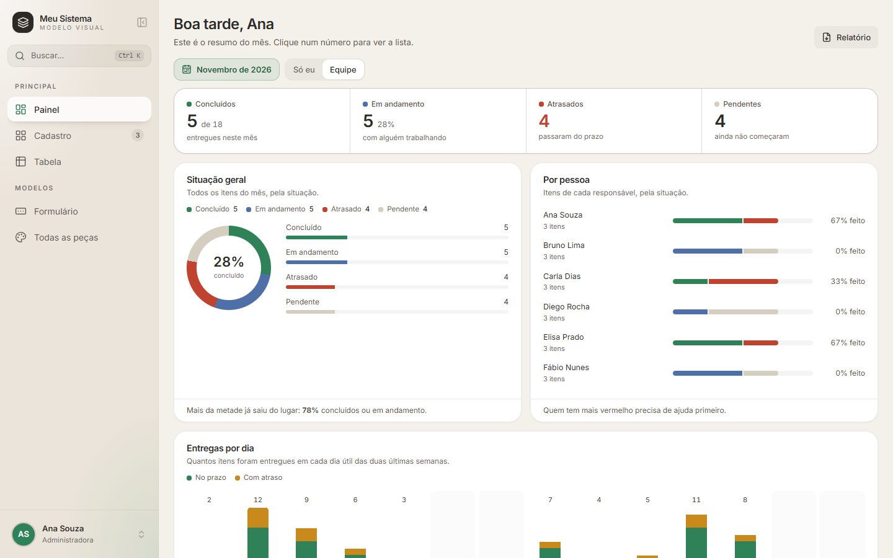
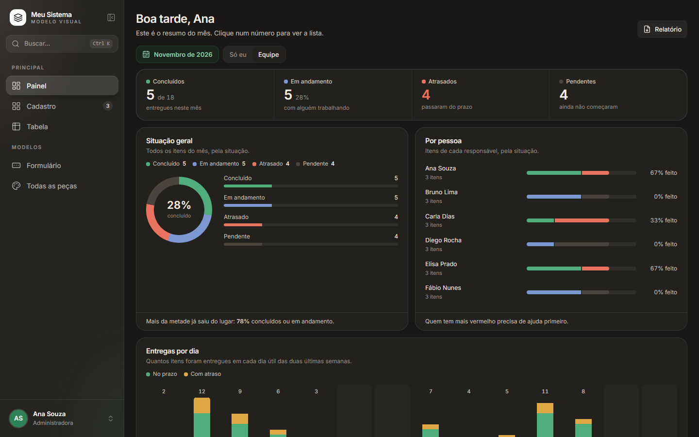

## Menu lateral

Arquivo: `componentes/layout/MenuLateral.tsx`.

Anatomia, de cima para baixo:

| Parte | Medidas e comportamento |
|---|---|
| Marca | Faixa de 72 px: `Marca` (34 px, quadrado `bg-tinta` com ícone) + nome do programa 14 px + subtítulo 9.5 px em caixa alta + botão de recolher. Recolhido: só a marca, que vira o ícone de "abrir" no hover. Troque `Marca` pelo logo (um arquivo para o claro, outro para o escuro). |
| Buscar | Botão `h-9` "Buscar…" com `Ctrl K`; dispara o evento `abrir-busca`. |
| Seções | Título 10.5 px caixa alta `tracking-[0.14em]`. **Clique dobra a seção** (mola), e o menu lembra quais ficaram dobradas. Seção dobrada com a tela ativa dentro mostra um pontinho `bg-marca`. Recolhido: os títulos viram traços de 24 px. |
| Itens | `h-10 rounded-xl px-3`, ícone 19 px, texto 14 px. Ativo: **pílula** (`--menu-ativo` + `--menu-ativo-sombra`) que **desliza** de um item ao outro, barrinha `bg-marca` de 3 × 20 px à esquerda, ícone `text-marca` e texto `font-medium`. Contador: bolinha à direita (ou no canto do ícone, recolhido). Recolhido: o nome aparece num balão ao passar o mouse. |
| Conta | Embaixo, com borda em cima: avatar 36 px `bg-acento` + nome + cargo. Abre um menu: *Meu perfil*, **Preferências** (*Menu automático*, *Tema escuro*, *Reduzir desfoque*, cada um com interruptor) e *Sair*. |

Larguras: **256 px** aberto, **72 px** recolhido (constantes `ABERTO` e `FECHADO`).

Recolher: botão no topo ou **Ctrl+B**. Fica lembrado.

**Menu automático**: o menu fica recolhido e **abre por cima da tela** quando o mouse chega
(recolhe 350 ms depois que sai). O espaço reservado continua de 72 px, então o conteúdo não
pula. Liga pela preferência ou sozinho quando a janela tem menos de 1100 px.

O que fica guardado no computador (`localStorage`): `menu_recolhido`, `menu_automatico`,
`menu_dobradas`, `tema`, `reduzir-desfoque`.

Fundo `bg-menu`, texto `text-tinta`, com dois brilhos radiais suaves (`--menu-brilho-1/2`) e uma
linha de 1 px à direita.

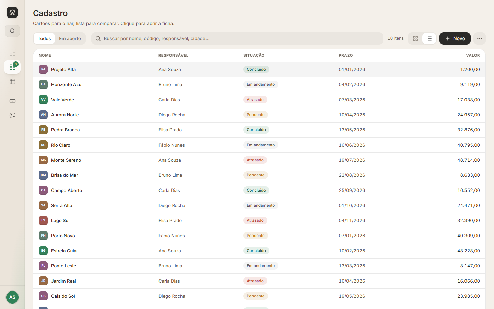
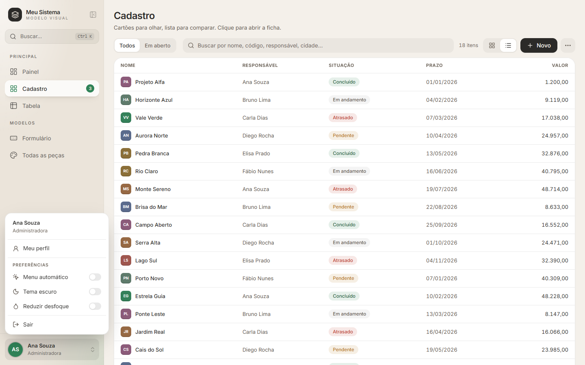

Escuro: `../imagens/escuro/menu-recolhido.png`, `../imagens/escuro/menu-conta.png`.

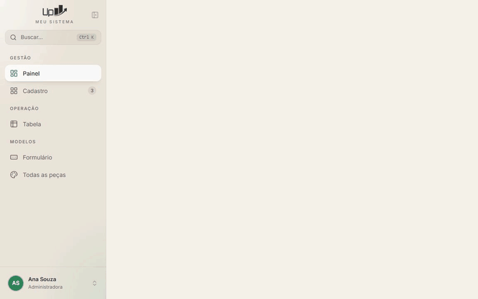

**Para montar o menu do programa:** faça o mapa das telas antigas (janelas, abas, itens do
`QMenuBar`), agrupe em 2–4 seções com o usuário, escreva `SECOES` em `telas.ts` com um ícone do
Lucide para cada tela e a `descricao` de uma linha. Troque o nome e o subtítulo da marca.

## Busca rápida (Ctrl+K)

Arquivo: `componentes/layout/BuscaRapida.tsx`. Abre com **Ctrl+K** (de qualquer lugar) ou pelo
botão "Buscar…" do menu (evento `window.dispatchEvent(new Event("abrir-busca"))`). Esc ou clique
fora fecham.

Anatomia: véu `bg-black/25` com leve desfoque; painel de **vidro** (`bg-vidro backdrop-blur-vidro`)
de 600 px, a 14% do topo, `rounded-cartao`, `shadow-janela`; campo de 56 px (16 px de letra) com
lupa e "Esc"; resultados em grupos com título 11 px caixa alta; item `h-11 rounded-xl` com ícone
18 px, nome e, à direita, onde fica; item escolhido com `bg-acento/12` e ícone em acento.

Grupos, nesta ordem:

1. **Ações** do dia a dia (no modelo: novo cadastro, trocar tema, sair).
2. **Abrir item**: itens do cadastro, só depois de 2 letras digitadas.
3. **Ir para · <seção>**: todas as telas de `SECOES`.

Filtro (`filtrar`): **cada palavra digitada precisa aparecer** (sem acento); começo de palavra
pesa mais. Nada de casar letras soltas.

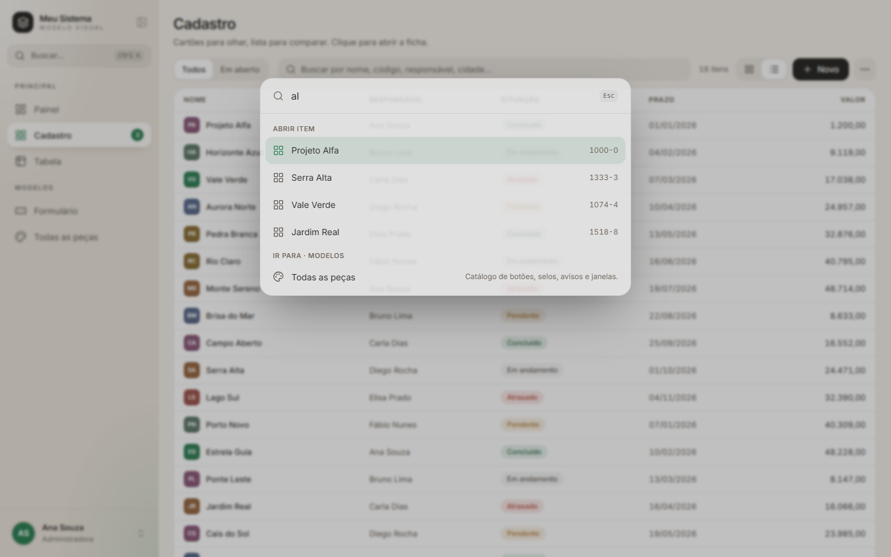
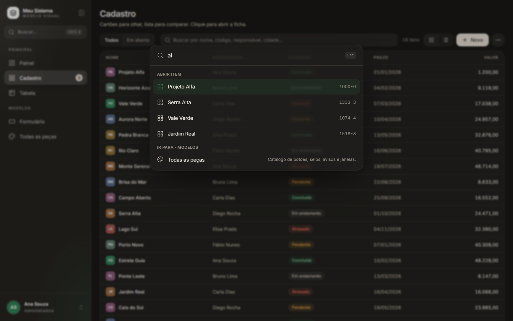

**Para adaptar:** troque as `acoes` pelas ações mais usadas do programa (atalhos de teclado e
itens de menu do Qt); troque `ITENS` pela lista real (vinda da mesma consulta da tela de cadastro)
e faça "abrir item" abrir a ficha daquele item.

## Cabeçalho e barra de ferramentas

Arquivo: `componentes/layout/JanelaPrincipal.tsx` (`CabecalhoTela`). Props: `titulo`,
`subtitulo?`, `acoes?` (botões à direita do título), `children` (a barra de ferramentas),
`className`.

Anatomia: `px-6 pt-6 pb-3`; título 24 px semibold; subtítulo 13.5 px `text-texto-2` (uma frase
que diz o que se faz na tela); barra `mt-4 flex flex-wrap items-center gap-2`. Tudo na barra tem
**36 px** de altura.

Ordem fixa da barra (da esquerda para a direita):

1. Filtros: `Segmentado` (Todos/Em aberto), `SeletorMes`.
2. Busca: `CampoBusca` (`flex-1`, ocupa o que sobra).
3. Contagem: `<span className="px-1 text-[12.5px] tabular-nums text-texto-3">{plural(n, "item", "itens")}</span>`.
4. Modo de ver: `Segmentado` com ícones (cartões/lista).
5. Botão principal: `<Botao className="h-9">` (variante `primario`), com ícone.
6. «…»: `MenuSuspenso` com as ações raras (importar, exportar).

Ações que valem para a tela toda, mas não são a principal (ex.: "Relatório"), vão em `acoes`
como `Botao variante="leve" tamanho="p" className="h-9"`.

```tsx
<CabecalhoTela titulo="Cadastro" subtitulo="Cartões para olhar, lista para comparar. Clique para abrir a ficha.">
  <Segmentado valor={filtro} opcoes={[["todos", "Todos"], ["abertos", "Em aberto"]]} aoMudar={setFiltro} />
  <CampoBusca valor={busca} aoMudar={setBusca} placeholder="Buscar por nome, código, responsável, cidade…" className="ml-2" />
  <span className="px-1 text-[12.5px] tabular-nums text-texto-3">{plural(itens.length, "item", "itens")}</span>
  <Segmentado valor={modo} opcoes={[["cartoes", <LayoutGrid key="g" className="size-4" />], ["lista", <List key="l" className="size-4" />]]} aoMudar={setModo} />
  <Botao className="h-9" onClick={aoNovo}><Plus className="size-4" /> Novo</Botao>
  <MenuSuspenso gatilho={...}>...</MenuSuspenso>
</CabecalhoTela>
```

---

## Cadastro (cartões ou lista + ficha)

Arquivo: `telas/Lista.tsx`. A tela ocupa a altura toda (`flex h-full flex-col`): cabeçalho fixo
em cima, área de conteúdo que rola (`min-h-0 flex-1 overflow-y-auto px-6 pb-8`).

**Estados**, nesta ordem: carregando → `Esqueleto`; nada para mostrar → `Vazio` com a ação que
resolve; senão, cartões ou lista.

**Cartões** (`Cartao`): grade `grid-cols-[repeat(auto-fill,minmax(320px,1fr))] items-start gap-3.5`.
Cada cartão:

```text
┌────────────────────────────────────────────┐  rounded-cartao, border-borda,
│ [Ícone 40]  Nome (14 semibold)     [Selo]  │  bg-superficie, shadow-cartao
│             código · cidade (12)           │  p-4, gap-3
│ ┌ CATEGORIA ─────┐ ┌ PRAZO ─────────┐      │  2 × Dado
│ └ Categoria A ───┘ └ 17/10/2026 ────┘      │
│ Progresso                          64%     │  BarraPartes altura 6
│ ▓▓▓▓▓▓▓▓▓▓▓▓░░░░░░                          │
├────────────────────────────────────────────┤  border-t, bg-campo/40, px-4 py-2
│ (Pessoas)                     R$ 12.345,00 │
└────────────────────────────────────────────┘
```

Hover: sobe 2 px, borda `border-acento/40`, `shadow-cartao-hover`. Foco por teclado: anel de
acento; Enter abre. Entram em cascata (`cascata(n)`).

**Lista** (`TabelaItens`): tabela num cartão `rounded-cartao`; cabeçalho fixo (`sticky top-0`)
11 px caixa alta `text-texto-3`; linhas `h-11` com borda entre elas e hover `bg-campo`; primeira
coluna com `IconeApp` de 26 px + nome `font-medium`; situação como `Selo`; números à direita em
`tabular-nums`.

**Ficha** (`Ficha`): `Gaveta` com o véu na cor do item (`corPorTexto(nome)`); cabeçalho com
`IconeApp` 60 px, nome 18 px, código e selos; corpo em grupos (`TituloGrupo` + grade
`grid-cols-2 gap-1.5` de `Dado`); rodapé com **Editar** (`primario`, `flex-1`) e **Apagar**
(`leve` com `text-perigo`, que pede `confirmar()`).

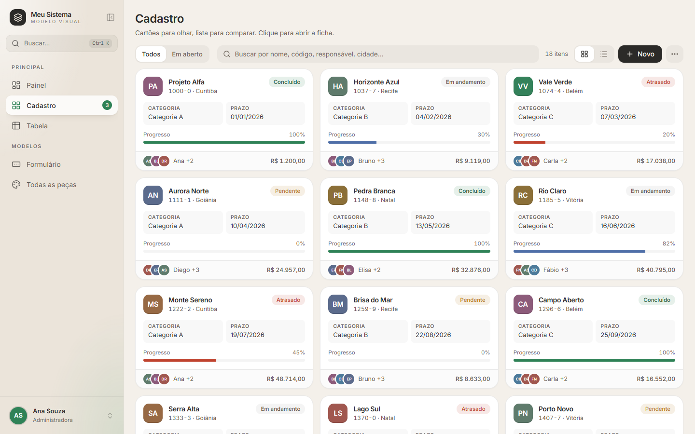
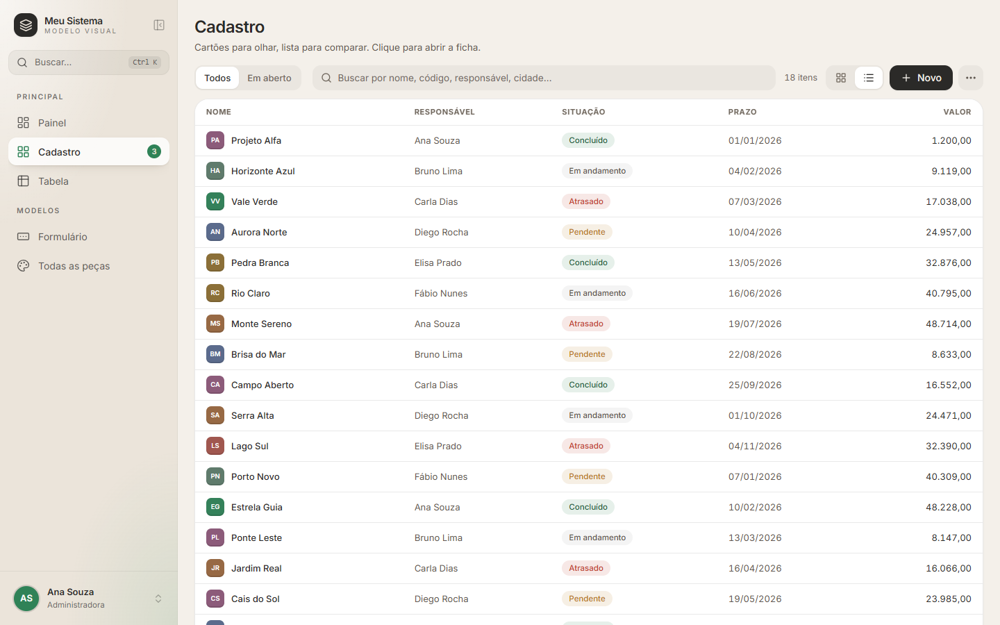
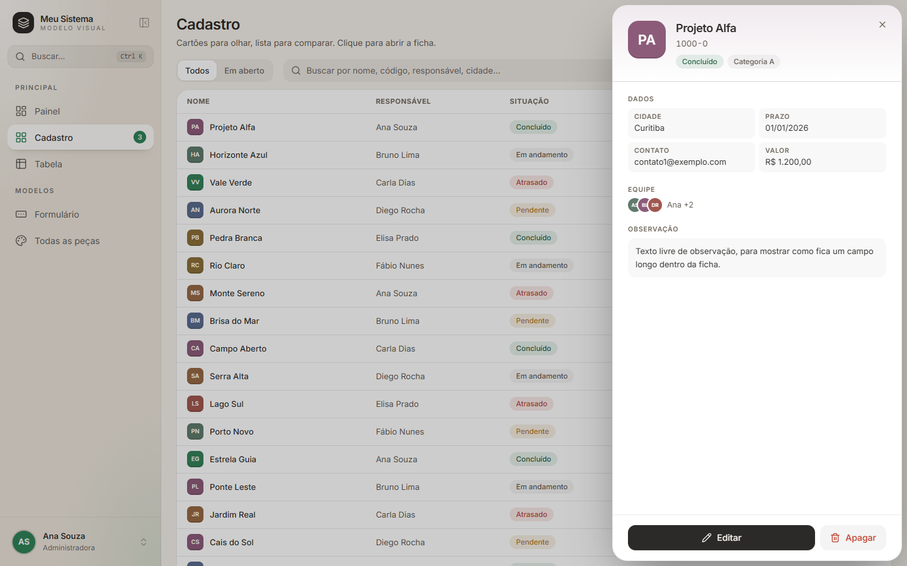

Escuro: `../imagens/escuro/cadastro-cartoes.png`, `../imagens/escuro/cadastro-lista.png`,
`../imagens/escuro/ficha-lateral.png`.

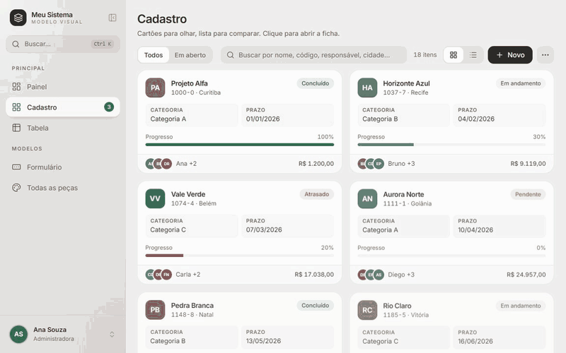
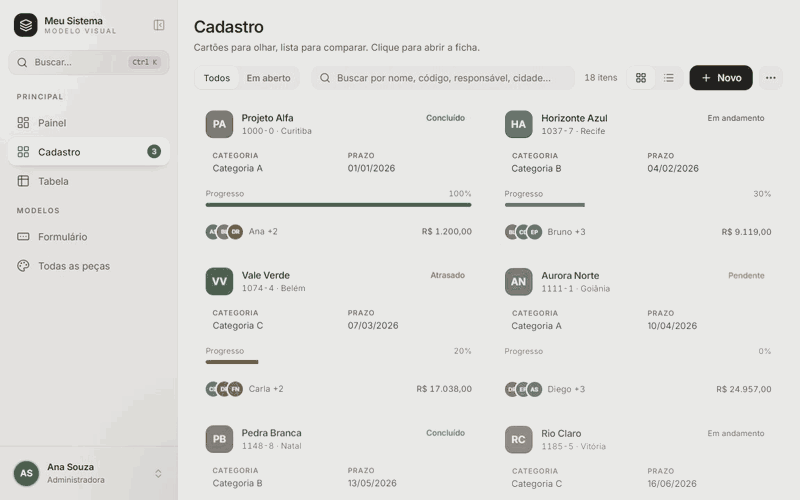

**Como montar uma tela de cadastro:**

1. Copie `telas/Lista.tsx` para `telas/<Nome>.tsx` e renomeie o componente.
2. Crie `src/api/<assunto>.ts` com a função de listar (padrão de `exemploApi`) e a porta em
   `backend/api/<assunto>.py` chamando o serviço.
3. Troque `useQuery({ queryKey: ["itens"], queryFn: exemploApi.itens })` pela sua função.
4. Defina o filtro do `Segmentado` (o filtro mais usado do programa antigo) e os campos que a
   busca olha (dentro do `semAcento(...)`).
5. Cartão: escolha 1 título, 1 linha de apoio, até 2 `Dado`, 1 `Selo` de situação e o rodapé
   (responsáveis + número). Não ponha tudo no cartão: o resto vai na ficha.
6. Lista: as colunas que a pessoa compara (até 5–6).
7. Ficha: todos os dados em grupos com `TituloGrupo`; ações do item no rodapé.
8. Registre a tela em `telas.ts` e `main.tsx`.

Se o programa antigo só tinha lista, ofereça os dois modos; se a pessoa prefere só um, tire o
`Segmentado` de modo.

## Painel

Arquivo: `telas/Painel.tsx`. A tela inicial: o que precisa de atenção, em números e gráficos.

Anatomia:

1. `CabecalhoTela` com saudação pelo horário ("Bom dia/Boa tarde/Boa noite, <nome>"), subtítulo
   que ensina ("Clique num número para ver a lista."), `SeletorMes` + `Segmentado` (só eu /
   equipe) na barra e "Relatório" em `acoes`.
2. Coluna `flex flex-col gap-3.5 px-6`, cada bloco num `motion.div {...cascata(n)}`:
   - `FaixaIndicadores` com 4 `Indicador` (2 colunas; 4 a partir de `@3xl`). Cada número clicável
     leva à lista filtrada.
   - Grade `grid gap-3.5 @4xl:grid-cols-2` com cartões de gráfico (`Painel` dos gráficos, com
     `className="h-full"` para igualar a altura).
   - Cartão largo (largura toda) para o gráfico de tempo (`Colunas`).
   - Uma faixa simples de atividade (avatares + frase).

Cada cartão de gráfico segue: título · o que mede · legenda (`Chave`) · gráfico · **leitura**
(a frase que diz o que concluir). Cores sempre pelos `--g-*` com o significado fixo.


**Como montar um painel:**

1. Pergunte ao usuário as 4 perguntas que ele faz toda manhã ("quantos atrasados?"). Cada uma
   vira um `Indicador`, com `referencia` ("de 90") e `explica`.
2. Para cada indicador importante, um cartão de gráfico que explica o número (por situação →
   `Rosca` + `BarraPartes`; por pessoa/categoria → `Barras`; no tempo → `Colunas`).
3. Escreva a `leitura` calculada a partir dos dados, não um texto fixo.
4. Os números vêm de uma porta própria (`/api/painel/...`) que soma no Python; a tela não soma
   milhares de linhas.

## Tabela densa

Arquivo: `telas/Tabela.tsx`. Para muitas linhas (o modelo mostra 600) com leitura rápida, como
planilha.

Anatomia:

- Cabeçalho da tela com `CampoBusca` (`max-w-md`) e a contagem de linhas.
- Cartão que ocupa o resto da altura: `mx-6 mb-6 flex min-h-0 flex-1 flex-col overflow-hidden rounded-cartao border border-borda bg-superficie shadow-cartao`.
- Cabeçalho das colunas `h-9 bg-campo/50`, 11 px caixa alta; **clique ordena** (de novo inverte),
  com seta na coluna ordenada.
- Linhas de **32 px** em **zebra** (`bg-zebra` nas ímpares), 13 px; hover `bg-campo`; clique marca
  a linha (`bg-acento/15` + faixa de 3 px de acento à esquerda).
- Números à direita em `tabular-nums`; textos longos com `truncate`.
- Rodapé `h-9 bg-campo/50` com o **total**, alinhado à coluna do valor.
- **Virtualizada** (`useVirtualizer`, `estimateSize: () => 32`, `overscan: 12`): só desenha as
  linhas que aparecem. As colunas são `flex` com larguras fixas (`w-16`, `w-32`...) e uma
  `flex-1` para o nome, iguais no cabeçalho e nas linhas.

Colunas definidas numa lista:

```ts
const COLUNAS: Coluna[] = [
  { campo: "id", nome: "Nº", largura: "w-16", direita: true },
  { campo: "nome", nome: "Nome", largura: "flex-1 min-w-[180px]" },
  { campo: "valor", nome: "Valor", largura: "w-32", direita: true },
];
```

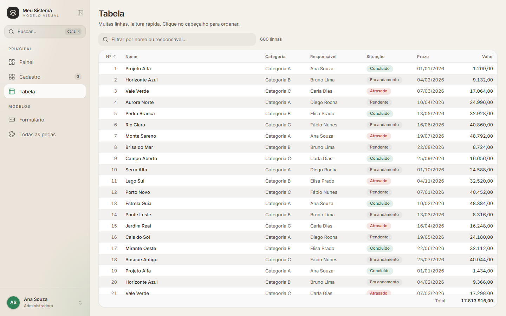
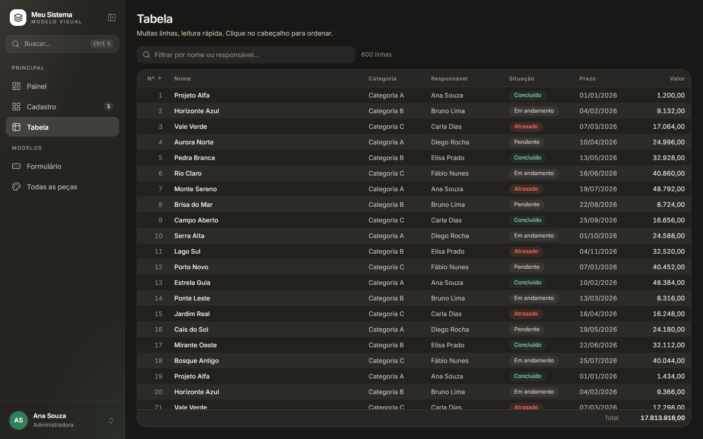

**Como montar uma tabela densa:**

1. Copie `telas/Tabela.tsx`. Troque `LINHAS` pelo `useQuery` da sua porta.
2. Escreva `COLUNAS` com as colunas do `QTableWidget` antigo, na mesma ordem. Números com
   `direita: true`.
3. Copie as mesmas larguras para as `<span>` de cada linha.
4. Ajuste o filtro da busca e o total do rodapé (o total deve vir do Python se for regra).
5. Menu de botão direito, filtro por coluna e edição na célula: acrescente sobre esta base,
   mantendo linha de 32 px, zebra e cabeçalho que ordena.

## Formulário

Arquivo: `telas/Formulario.tsx`. React Hook Form + Zod.

Anatomia:

- `CabecalhoTela` com título ("Novo cadastro") e subtítulo; sem barra.
- Um cartão `mx-6 max-w-3xl rounded-cartao border border-borda bg-superficie p-6 shadow-cartao`.
- Grupos: `TituloGrupo` + grade `grid gap-4 @2xl:grid-cols-2` (2 colunas quando cabe). Entre
  grupos, divisória `my-6 h-px bg-borda`.
- Campo de texto: `CampoRotulado {...register("campo")}` com `erro={e.campo?.message}`.
- Campo que não é `<input>` (`Escolha`, `Lista`, `SeletorData`, `SeletorHora`, `Interruptor`,
  `CaixaSelecao`): dentro de `<Controller render={({ field }) => ...} />`, ligando
  `valor={field.value}` e `aoMudar={field.onChange}`.
- Liga/desliga juntos numa linha `mt-5 flex flex-wrap gap-6`.
- **Erro**: embaixo de cada campo, em vermelho; e, ao tentar salvar, `AvisoErro` no fim
  ("Confira os campos marcados em vermelho."), que rola até ele e repete num balão.
- **Ações no rodapé, à direita**: `mt-6 flex justify-end gap-2 border-t border-borda pt-5`, com
  *Cancelar* (`leve`) e *Salvar* (`acento`, `type="submit"`, `carregando={formState.isSubmitting}`).

```tsx
const esquema = z.object({
  nome: z.string().trim().min(3, "Escreva pelo menos 3 letras."),
  codigo: z.string().trim().regex(/^\d{4}-\d$/, "Use o formato 0000-0."),
  equipe: z.array(z.string()).min(1, "Escolha ao menos uma pessoa."),
});
const { register, control, handleSubmit, formState } = useForm<Dados>({ resolver: zodResolver(esquema), defaultValues: { ... } });

<form onSubmit={handleSubmit(salvar, () => setErroGeral("Confira os campos marcados em vermelho."))}>
```

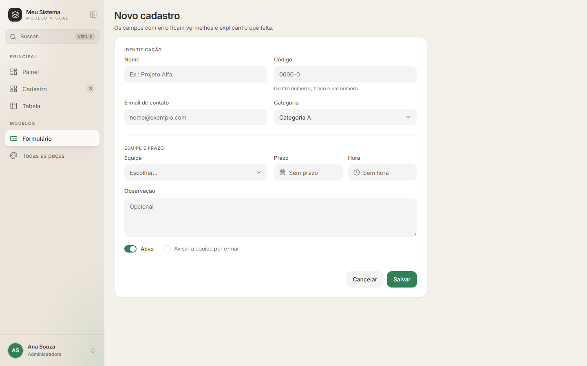
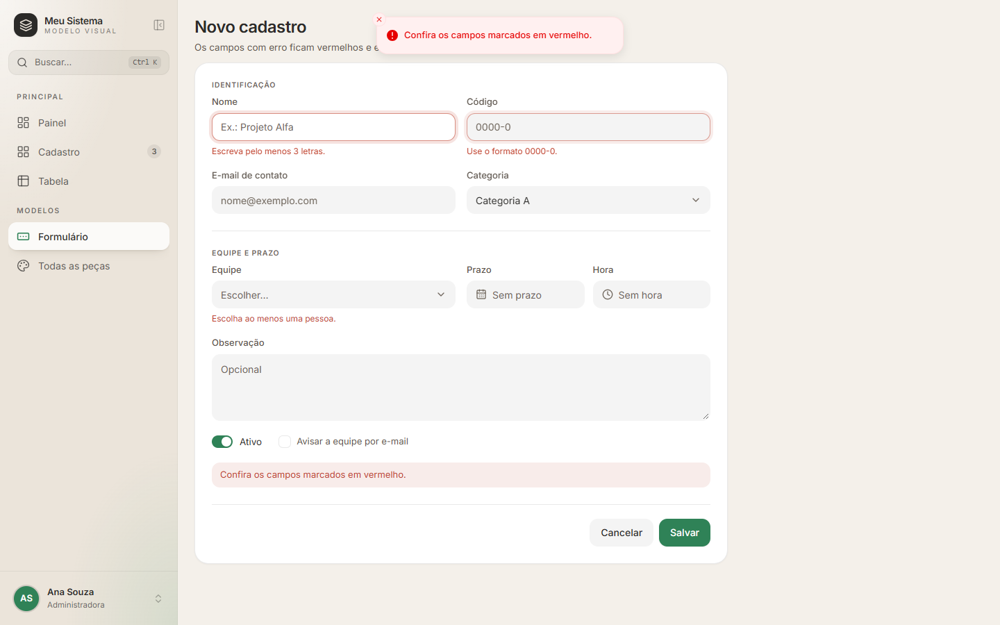

Escuro: `../imagens/escuro/formulario.png`, `../imagens/escuro/formulario-erros.png`.

**Como montar um formulário:**

1. Copie `telas/Formulario.tsx`.
2. Liste os campos do `QDialog`/tela antiga e agrupe (2–4 grupos com `TituloGrupo`).
3. Escreva o `esquema` Zod com as mesmas regras do programa antigo e mensagens que dizem o que
   fazer. Repita as regras **também** no serviço Python (é ele quem decide).
4. Troque cada widget pelo equivalente ([08-componentes.md](08-componentes.md), quadro do Qt).
5. No `salvar`, chame a porta (`useMutation`); sucesso → `toast.success` e volta; erro do Python
   vira balão sozinho ou, se for de um campo, use `setError` do React Hook Form.
6. Formulário curto (1–3 campos) não é tela: é um `Dialogo`.

## Entrada (login)

Arquivo: `telas/Entrada.tsx`. Prop: `aoEntrar()`.

Anatomia:

- **Fundo animado** (`FundoAnimado`): degradê radial com `--cena-1/2/3` e 4 clarões grandes
  que flutuam devagar (só `transform`).
- Botão de tema no canto superior direito (36 px, redondo, `bg-tinta/10`).
- Marca (54 px) + nome do programa em caixa alta 13 px `tracking-[0.3em]`.
- **Cartão de vidro** (até 420 px): `rounded-[calc(var(--raio-janela)+4px)] border-white/40 bg-vidro backdrop-blur-vidro backdrop-saturate-150 px-8 pb-7 pt-16`.
- **Avatar de 96 px saindo por cima** do cartão: ícone neutro antes; ao digitar o usuário,
  vira as iniciais na cor da pessoa (troca com mola) e aparece "Olá, <nome>".
- `Campo` usuário (ícone `User`) e senha (ícone `KeyRound`, olho para mostrar em `fim`). Enter
  no usuário pula para a senha.
- "Lembrar meu login" (`CaixaSelecao`) e "Esqueci a senha" (link em acento).
- Botão *Entrar* `primario` `tamanho="g"` largura toda, com `carregando`.
- "Conectado" com pontinho de acento; versão no canto inferior direito (11 px).
- **Erro**: o cartão **treme**, o campo que falta fica vermelho e um balão diz o quê.

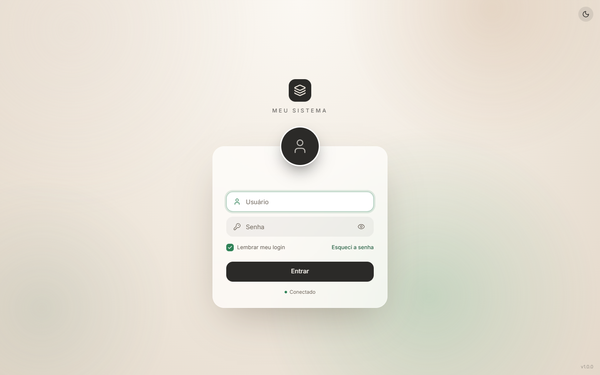
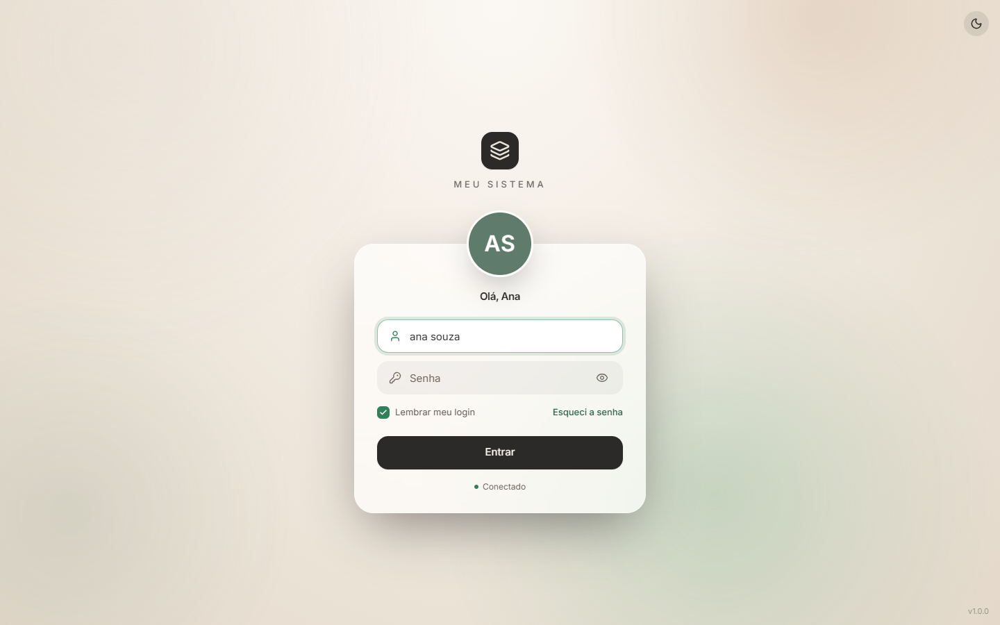
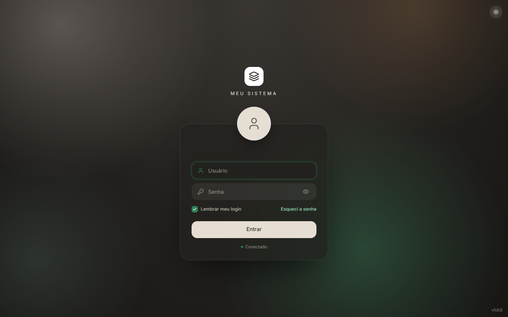

Escuro com usuário: `../imagens/escuro/entrada-com-usuario.png`.

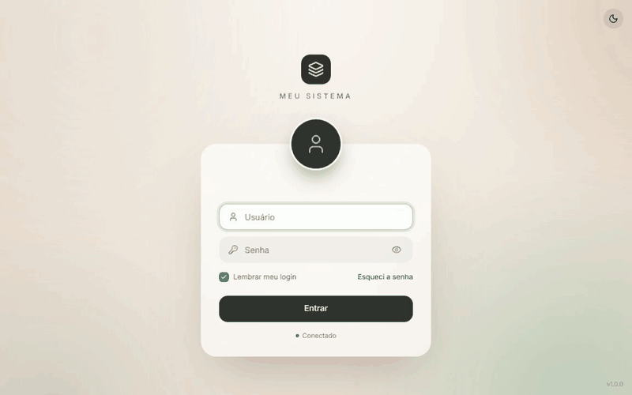

**Como adaptar a entrada:**

1. Na vitrine qualquer usuário entra. Crie uma porta `POST /api/sessao/entrar` que chama a
   verificação de senha do motor antigo.
2. Em `entrar()`: depois das checagens de vazio, chame a porta; sucesso → `aoEntrar()`; erro →
   `falhar(motivo)` (treme + balão com o `detail` do Python).
3. Foto da pessoa: troque as iniciais por `` no `AvatarEntrada` quando houver foto.
4. "Lembrar meu login": guarde só o usuário (nunca a senha) no `localStorage`.
5. Ajuste as cores fixas dos clarões (`CLAROES`) à paleta escolhida.
6. Sem login no programa antigo: tire a rota `/` e abra direto em `/app/<tela inicial>`.
