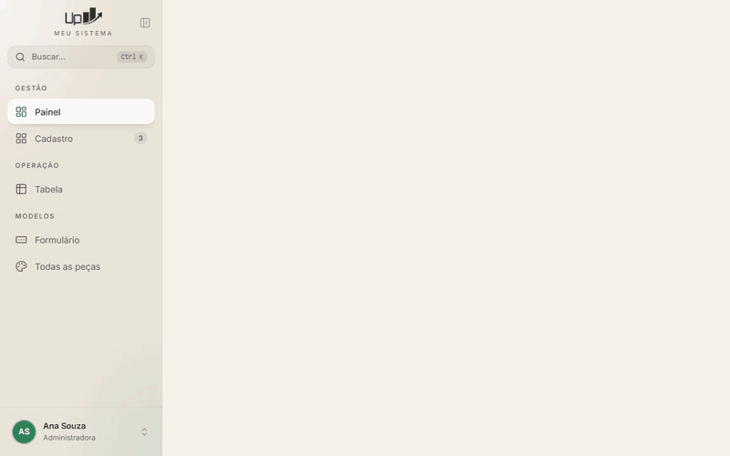
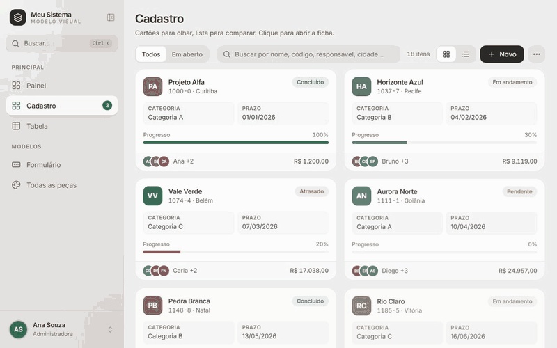
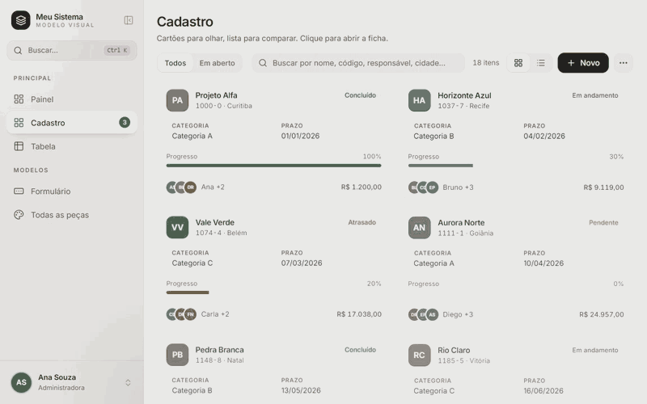
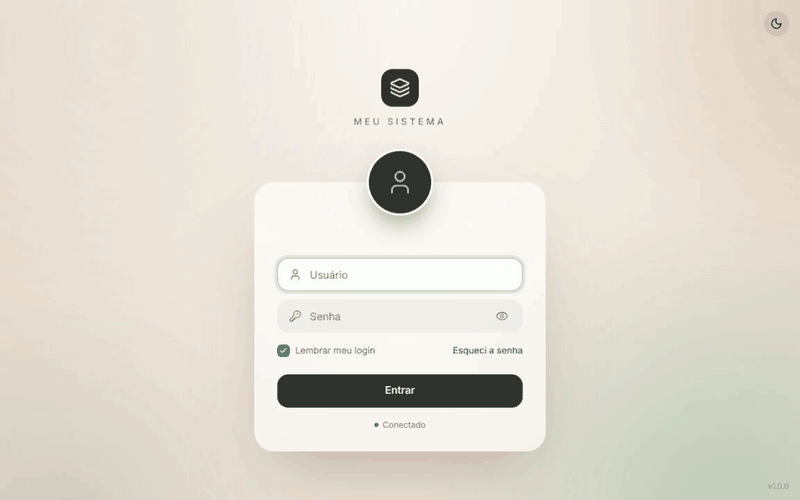

# 10 · Animações

> **Para a IA.** Movimento é parte do visual, não enfeite. Use só os valores de
> `modelo/frontend/src/tema/movimento.ts`, só nas situações deste capítulo, e nunca anime o
> que pesa (blur, tamanho em lista grande).

Biblioteca: **Motion** (`import { motion, AnimatePresence } from "motion/react"`). O jeito é o do
macOS: **mola** que começa rápida e assenta sem quicar.

## Os valores (`src/tema/movimento.ts`)

| Nome | Valor | Onde é usado |
|---|---|---|
| `MOLA` | `{ type: "spring", stiffness: 420, damping: 38 }` | Menu lateral: largura ao recolher, item ativo deslizando, seções dobrando. |
| `MOLA_JANELA` | `{ type: "spring", stiffness: 420, damping: 32 }` | `Dialogo` entrando (e por isso `confirmar()` e `Confirmacao`). |
| `MOLA_RAPIDA` | `{ type: "spring", stiffness: 500, damping: 36 }` | Busca Ctrl+K entrando; pílula do `Segmentado`. |
| `MOLA_MACIA` | `{ type: "spring", stiffness: 260, damping: 26 }` | Cartão da tela de entrada (com `delay: 0.08`). |
| `SUAVE` | `[0.22, 1, 0.36, 1]` (curva) | O que não é mola: a marca da entrada aparecendo (`duration: 0.6`). |
| `cascata(i)` | `initial { opacity: 0, y: 8 }` → `animate { opacity: 1, y: 0 }`, `duration: 0.25`, `delay: Math.min(i, 12) * 0.025` | Cartões do cadastro e blocos do painel entrando um depois do outro (25 ms entre cada, no máximo 12 de espera). |

Uso:

```tsx
import { MOLA, cascata } from "@/tema/movimento";

<motion.div animate={{ width: recolhido ? 72 : 256 }} transition={MOLA} />
{itens.map((i, n) => <motion.div key={i.id} {...cascata(n)}>...</motion.div>)}
```

Não escreva números de mola soltos nos componentes: crie (ou reuse) um nome em `movimento.ts`.

## Cada animação do sistema

| Animação | Como é feita | Arquivo |
|---|---|---|
| **Item ativo do menu deslizando** | A pílula é um `motion.span` com `layoutId="menu-ativo"` (e a barrinha com `layoutId="menu-barra"`), `transition={MOLA}`. Ao trocar de tela, o Motion leva a pílula do item velho ao novo. | `layout/MenuLateral.tsx` |
| **Seção do menu dobrando** | `motion.div` com `animate={{ height: dobrada ? 0 : "auto", opacity: dobrada ? 0 : 1 }}`, `MOLA`, `initial={false}`. A setinha gira por CSS (`-rotate-90`). | `layout/MenuLateral.tsx` |
| **Menu recolhendo** | `motion.div` (o espaço) e `motion.aside` (o menu) animam `width` entre 256 e 72 com `MOLA`. A marca troca pelo botão "abrir" com `AnimatePresence mode="popLayout"` (opacidade + escala 0.8). | `layout/MenuLateral.tsx` |
| Ícone do menu ao clicar | `group-active:scale-90` (CSS). | `layout/MenuLateral.tsx` |
| **Janela entrando de 94%** | Véu: opacidade em 0.2 s. Janela: `initial { opacity: 0, scale: 0.94, y: "-46%" }` → `animate { opacity: 1, scale: 1, y: "-50%" }`; sai para `scale: 0.96, y: "-48%"`. `MOLA_JANELA`. | `ui/dialogo.tsx` (`Dialogo`) |
| **Gaveta** | Animação própria do **Vaul** (`direction="right"`): desliza da direita e acompanha o dedo/mouse ao arrastar para fechar. | `ui/dialogo.tsx` (`Gaveta`) |
| **Busca entrando** | Véu: opacidade 0.15 s. Painel: `initial { opacity: 0, scale: 0.96, y: -8 }` → `{ opacity: 1, scale: 1, y: 0 }`; sai para `scale: 0.98, y: -4`. `MOLA_RAPIDA`. | `layout/BuscaRapida.tsx` |
| **Segmentado** | Pílula `motion.span` com `layoutId={\`seg-${grupo}\`} (`grupo = useId()`)` e `MOLA_RAPIDA`: desliza até a opção escolhida. | `ui/marcadores.tsx` |
| **Cartões em cascata** | `{...cascata(n)}` em cada cartão e em cada bloco do painel. | `telas/Lista.tsx`, `telas/Painel.tsx` |
| **Cartão subindo no hover** | CSS: `hover:-translate-y-0.5` (2 px) + `hover:shadow-cartao-hover` + `hover:border-acento/40`, `transition-[box-shadow,transform,border-color] duration-200`. | `telas/Lista.tsx` (`Cartao`) |
| **Botão afundando** | CSS: `active:scale-[0.97]`, `transition-all duration-200`. | `ui/botao.tsx` |
| Botão carregando | Ícone `Loader2` com `animate-spin`. | `ui/botao.tsx` |
| Lista suspensa abrindo | A seta gira 180° (CSS `rotate-180`). | `ui/lista.tsx` |
| Interruptor | Bolinha com `translate-x-3` e `transition` (CSS). | `ui/marcadores.tsx` |
| **Tremida do login** | `useAnimationControls()`; no erro: `tremer.start({ x: [0, -10, 10, -7, 7, -3, 0], transition: { duration: 0.45 } })`. | `telas/Entrada.tsx` |
| **Avatar trocando** | `AnimatePresence mode="popLayout"` com `key` = iniciais: o velho sai encolhendo para 0.6 e o novo entra crescendo, mola `stiffness: 380, damping: 26`. "Olá, <nome>" entra subindo 4 px (`mode="wait"`). | `telas/Entrada.tsx` (`AvatarEntrada`) |
| Entrada abrindo | Marca: `y: -12 → 0`, 0.6 s, `SUAVE`. Cartão: `y: 24, scale: 0.97 → 0, 1`, `MOLA_MACIA` com `delay: 0.08`. | `telas/Entrada.tsx` |
| **Clarões do fundo** | 4 `motion.div` com degradê radial **pronto**, movendo só `x`/`y` (`transform`) em vaivém de 26 a 34 s, `repeat: Infinity`, `ease: "easeInOut"`, `will-change-transform`. | `telas/Entrada.tsx` (`FundoAnimado`) |
| **Barra de rolagem que só aparece rolando** | `ligarBarraDiscreta()` marca o elemento que rola com `data-rolando` por 900 ms; o CSS só pinta o polegar com `[data-rolando]` (ou no hover dele). Barra de 10 px, sem trilho. | `lib/rolagem.ts`, `src/index.css` |
| **BarraOcupada** | Pedaço de 1/3 de acento com `animation: deslizar 1.2s ease-in-out infinite` (`translateX(-110%)` → `translateX(310%)`). | `ui/pecas.tsx`, `@keyframes deslizar` em `src/index.css` |
| Esqueleto | `animate-pulse` do Tailwind. | `ui/pecas.tsx` |
| Balões | Animação própria do Sonner. | `src/main.tsx` |









## Regras

1. **Anime só `transform` e `opacity`** (posição, escala, rotação, transparência). A placa de
   vídeo faz sem redesenhar a tela. Exceções que existem no modelo, conscientes: a **largura** do
   menu lateral e a **altura** das seções que dobram (elementos pequenos, poucas vezes). Não
   repita isso em lista, tabela ou cartão.
2. **Nada de blur animado.** Nunca anime `filter: blur()` nem `backdrop-filter`. O fundo da
   entrada usa degradês radiais prontos que só se movem; com `blur()` + `left/top` cai para uns
   30 quadros por segundo. Um véu desfocado pode **aparecer** (animando a opacidade dele), mas o
   valor do desfoque não muda durante a animação.
3. **Menos animação para quem pediu.** O `main.tsx` envolve tudo em
   `<MotionConfig reducedMotion="user">`: se o Windows está com "efeitos de animação" desligados,
   o Motion tira os movimentos de posição e escala (fica só a troca de opacidade). As animações
   feitas por CSS (`animate-pulse`, `animate-spin`, `deslizar`, hover do cartão) não são
   cobertas por isso; para elas, use as variantes `motion-reduce:` do Tailwind se precisar.
4. **"Reduzir desfoque".** No menu da conta (Preferências). Põe a classe `sem-desfoque` no `<html>`
   (`lib/desfoque.ts`, guardado em `localStorage` como `reduzir-desfoque`), e o CSS tira
   **todo** `backdrop-filter` do programa. Bom para PC fraco.
5. **Lista grande não anima item por item.** A `cascata` para no 12º item; tabela densa
   (virtualizada) não tem animação de linha.
6. **Duração curta.** Aparecer/sumir: 0.15–0.25 s. Mola: os valores acima. Nada passa de 0.6 s,
   exceto o fundo da entrada, que é decorativo e contínuo.
7. Animação nunca atrasa o trabalho: o clique vale na hora; o movimento acompanha.

## Mais sóbrio ou desligado

Se a entrevista pediu "menos animação" ou "mais sério":

| Pedido | O que mudar |
|---|---|
| Menos balanço | Em `movimento.ts`, aumente o `damping` (ex.: `MOLA` 38 → 50, `MOLA_JANELA` 32 → 45, `MOLA_RAPIDA` 36 → 48, `MOLA_MACIA` 26 → 40). Mola com damping alto chega sem passar do ponto. |
| Mais rápido | Aumente o `stiffness` (ex.: 420 → 600) e diminua a `duration` da `cascata` (0.25 → 0.15). |
| Sem cascata | Faça `cascata` devolver nada: `export const cascata = (_i: number) => ({});`. Os cartões aparecem todos juntos. |
| Sem cartão subindo | Em `telas/Lista.tsx`, tire `hover:-translate-y-0.5` (fica só a sombra e a borda). |
| Fundo da entrada parado | Em `FundoAnimado`, tire o `animate` (ou deixe só o degradê de `--cena-*`). |
| Desligar quase tudo | Em `main.tsx`, `reducedMotion="always"`: o Motion deixa só as trocas de opacidade. |

Os estilos prontos `sobrio.css` e `minimalista.css` pedem, no comentário do topo, molas com mais
amortecimento ("damping maior" / "damping 50+"). Ver [07-cores-e-medidas.md](07-cores-e-medidas.md).
